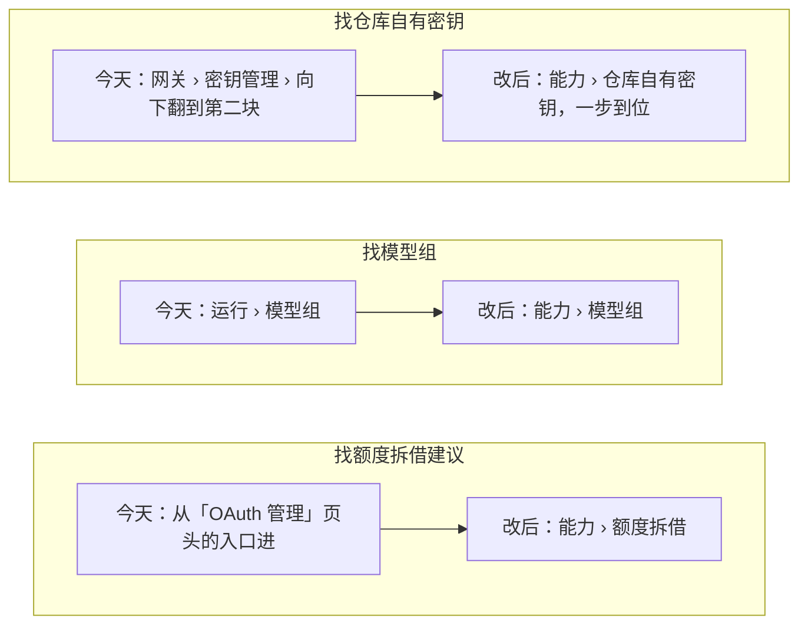
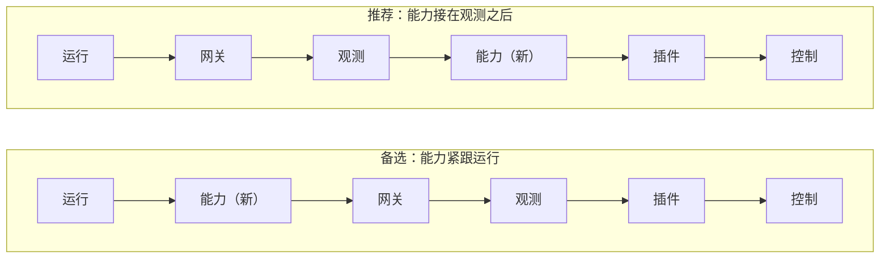
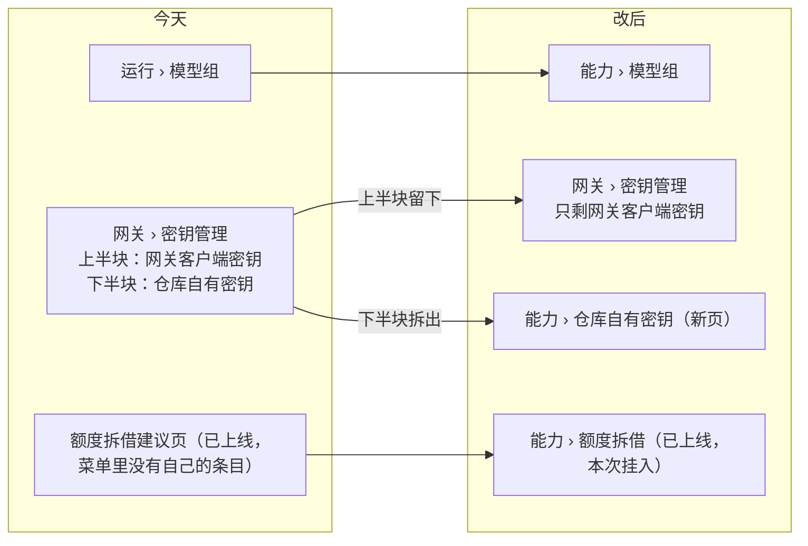
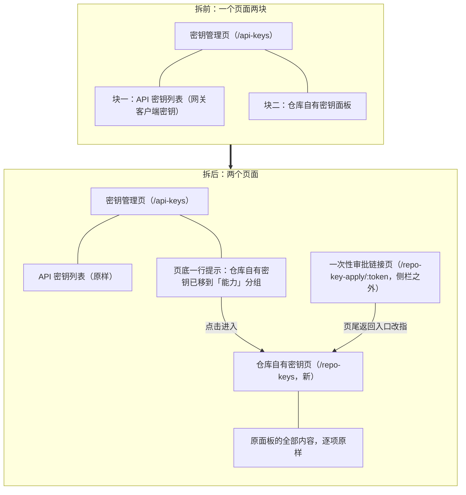
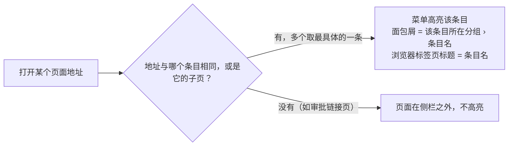

# PRD：左侧导航新增「能力」分组

状态：定稿（成员清单与分组位置两项已定，见第 6 节）
日期：2026-11-24（首版 2026-11-23）
来源：见第 12 节「来源记录」

## 1. 背景与目标

### 1.1 需求原话与理解

需求方在 2026-11-23 附一张左侧导航截图，原话：

> omc 那边，二级栏把之前的分 key，模型组这些，做成一个能力栏目，放里面，能懂吗？

截图是中文界面的左侧栏：五个分组（运行、网关、观测、插件、控制），分组标题是小号灰字；需求方只框出了「运行」「网关」「观测」三个分组标题。需求方此前把额度拆借建议这类功能统称为「CPA 运维的相关能力」。

下表区分「已核实的事实」和「本方案的理解（推断）」；推断部分已请需求方在评审里核实，没有被否认。

| 原话里的词 | 本方案的理解 | 性质 | 依据 |
|---|---|---|---|
| 二级栏 | 左侧栏里「运行 / 网关 / 观测…」这一层分组标题；「能力」是与它们并排的又一个分组 | 推断，评审中没有被否认 | 截图红框框的正是三个分组标题 |
| 分 key | 界面名叫「仓库自有密钥」（Repository keys）；今天没有独立页面，是「密钥管理」页里网关密钥列表下面的第二块面板 | 词义是事实，「指的就是它」是推断，评审中没有被否认 | 团队内部把「每个仓库一把密钥」这条线叫分 key；界面上只有这一处 |
| 模型组 | 「运行」分组里的「模型组」页，含列表、详情、添加成员三种页面 | 事实 | 截图与现有菜单一致 |
| 这些 | 不止两项：还包括团队自己做的、能一句话说清「它替人做什么」的功能，据此把额度拆借建议也列入 | 推断 | 「这些」是复数；需求方把额度拆借建议称作「CPA 运维的相关能力」 |

> [!决策] 红框的读法：按「再加一个并排的新分组」定稿
> 需求方只框了「运行」「网关」「观测」，没有框「插件」「控制」。本方案读作「这一层就是二级栏」，「能力」是与它们并排的又一个分组；另一种读法是「想从这三个分组里各挑几项放进能力」。评审中前一种读法没有被否认，也没有点名增减条目，所以按前一种定稿。5.2 仍把这三个分组的每个条目都列出并写明去留；日后读法若有变，只改成员清单，分组机制不受影响。

### 1.2 现状

左侧栏的分组与条目（地址是页面的访问路径）：

| 分组 | 条目（地址） |
|---|---|
| 运行 | 仪表盘（`/dashboard`）、智能体（`/agent`）、操练场（`/playground`，演示模式没有）、模型广场（`/model-square`）、模型组（`/model-groups`） |
| 网关 | AI 提供商（`/ai-providers`）、OAuth 管理（`/oauth-management`）、密钥管理（`/api-keys`） |
| 观测 | 洞察（`/insights`）、请求记录（`/usage/events`）、费用与用量（`/pricing`）、日志查看（`/logs`）、操作审计（`/audit`） |
| 插件 | 插件管理（`/plugins`）、插件商店（`/plugins/store`），以及每个运行中的插件登记的页面（因部署而异） |
| 控制 | 配置面板（`/config`）、OMC 设置（`/omc-settings`）、系统信息（`/system`） |

- **模型组**是团队自有的功能：给一批模型起名、排顺序；除列表页外还有详情页（`/model-groups/:id`）和添加成员页（`/model-groups/:id/add`）。
- **仓库自有密钥**现在是「密钥管理」页的第二块面板，排在网关密钥列表下面：agent 通过 MCP 申请，运营人员审批一次；控制台只显示掩码，明文只在明确查看并留审计时才显示。面板含搜索与状态筛选、「代 agent 提交申请」、待审批、待交付、密钥列表（详情与用量、停用、重新启用、查看明文）、审计平台推送状态。agent 拿到的一次性审批链接页（`/repo-key-apply/:token`）在侧栏之外，页尾有回到「密钥管理」的入口。
- **额度拆借建议**页由另一项需求（交付目录 2026-11-23-omc-quota-lending）开发，一期已于 2026-11-24 合入主线：页面地址是平铺的 `/quota-lending`，页标题「额度拆借建议」，自带菜单短名「额度拆借」。入口是「OAuth 管理」页头统计行末尾的一个可点小项；打开该页时，菜单高亮、页面顶部路径和浏览器标签页标题暂时都借用「OAuth 管理」，菜单里还没有它自己的条目。

### 1.3 目标与非目标

目标：

- **G1**　左侧栏新增一个「能力」分组，把团队自己做的、能一句话说清「它替人做什么」的功能放在一起。
- **G2**　「分 key」在菜单里有自己的一行：把仓库自有密钥从「密钥管理」页拆成独立页。
- **G3**　只调导航与信息架构，不改各页面自身的功能；现有地址、已存的隐藏设置全部兼容。
- **G4**　额度拆借建议页（已上线）这次挂进「能力」第三项，高亮落在它自己，不再借用别的条目。

非目标：不改任何页面自身的功能；不搬「OAuth 管理」；不新增设置项；不新增对外（MCP）能力；不改额度拆借建议页本身。

## 2. 用户与场景

用户是**运营人员**：日常登录控制台，管理网关、凭证、模型组、仓库密钥和额度的人。他们靠左侧栏找页面，靠分组标题判断「这一堆是干什么的」；侧栏上的位置就是他们的使用习惯，所以改动要让老位置尽量不动、新位置好找。

下表是六个典型场景，「今天」按现有菜单写，「改后」按推荐方案写（位置与成员以第 6 节的结论为准）。

| 场景 | 今天怎么找 | 改后怎么找 |
|---|---|---|
| 看或调整模型组 | 运行 › 模型组 | 能力 › 模型组 |
| 审批、停用、查看某个仓库的密钥，或代 agent 提交申请 | 网关 › 密钥管理，向下翻到第二块 | 能力 › 仓库自有密钥 |
| 管理连网关用的客户端密钥（增删、改名、看用量） | 网关 › 密钥管理 | 网关 › 密钥管理，不变 |
| 看额度拆借建议 | 从「OAuth 管理」页头的入口进入，菜单里没有它自己的条目 | 能力 › 额度拆借 |
| 收到 agent 发来的一次性审批链接 | 打开链接批准，页尾回「密钥管理」 | 打开链接批准，页尾回「仓库自有密钥」 |
| 用老书签或老链接打开页面 | 直接打开原地址 | 直接打开原地址，结果不变；只有「仓库自有密钥」那块换成一行指路 |

图：受影响的找页面路径有三条（额度拆借建议页已上线，这次挂入）；其余页面的找法一概不变。

## 3. 范围

### 做

1. 左侧栏新增「能力」分组，位置按 q02 的结论：「观测」之后、「插件」之前。
2. 分组成员按 q01 的结论：模型组（从「运行」搬来）、仓库自有密钥（从「密钥管理」页拆出的独立页）、额度拆借（页面已上线，本次挂入第三项）。
3. 拆页：仓库自有密钥独立成页；「密钥管理」页只留网关客户端密钥，页底加一行指向新页的提示；一次性审批链接页的返回入口改指新页。
4. 「能力」分组名与新条目名在四种语言（简体中文、英文、繁体中文、马来文）里都有。
5. 侧栏的所有呈现同步：展开栏、收起栏、手机抽屉、「OMC 设置」里的侧栏面板、页面刚打开时的占位侧栏、演示模式。
6. 面包屑与菜单高亮随条目换组自动跟着变。
7. 相关文档同步：设计说明里写死的分组名、术语表的侧栏可见性条目、产品说明里的页面清单、对外能力说明里「仓库自有密钥在密钥管理页上」的描述；术语表补一条导航分组的说明（见第 4 节）。

### 不做

- **不改任何页面自身的功能**：模型组各页、密钥管理页上半块、OAuth 管理页、额度拆借建议页本身都不动；没有新增请求、没有新增写操作。
- **不搬「OAuth 管理」**，也不拆它里面的账号自动管理、Ollama 监控、额度卡（理由见 5.2）。
- **不迁移已存设置、不加重定向**：现有地址全部保持可用，已存的隐藏设置继续生效。
- **不新增设置项**：「能力」分组没有自己的开关，沿用现有的按条目隐藏。
- **不新增对外（MCP）能力，不改审批流程**：仓库密钥的申请、审批、交付规则一概不变，只换页面位置。
- **不动「观测」「插件」「控制」三个分组**及其条目；「运行」「网关」除上面写明的搬动外原样保留。

## 4. 术语

| 术语 | 含义 | 说明 |
|---|---|---|
| 分组（分组标题） | 左侧栏里一组条目上方的小号灰字标题；需求原话里的「二级栏」 | 现有五个：运行、网关、观测、插件、控制 |
| 条目 | 左侧栏里的一行，对应一个页面 | 条目的身份是它的页面地址；隐藏设置也按地址记 |
| 能力分组 | 本需求新增的分组，中文「能力」，英文 Capabilities | **只是导航分组**，里面放给人用的管理页；与研发术语 Capability 不同义，见下方提示 |
| 仓库自有密钥（分 key） | 每个仓库一把专属密钥：agent 通过 MCP 申请，运营人员审批一次；控制台只显示掩码，明文只在明确查看并留审计时显示 | 英文 Repository keys；今天是「密钥管理」页的第二块面板 |
| 网关客户端密钥 | 连接网关用的 API 密钥，由「密钥管理」页上半块的列表管理 | 列表里每把密钥会标出它属于哪个仓库，或「未绑定仓库」；这是列表自己的功能 |
| 隐藏条目 | 「OMC 设置」里按条目关闭菜单显示的设置；页面仍可用地址打开 | 按页面地址记，不按分组记；「OAuth 管理」「OMC 设置」锁定、不可隐藏 |
| 高亮、面包屑 | 高亮：当前页在菜单里的选中态；面包屑：页面顶部「分组 › 条目」路径 | 按页面地址匹配条目：地址相同，或是它的子页；多条都匹配取最具体的一条；不看地址后面的查询参数 |
| 收起栏 | 桌面端把侧栏收成只剩图标的窄栏 | 没有分组标题，所有条目按分组顺序拉平成一列 |
| 手机抽屉 | 窄屏上从左侧滑出的菜单 | 有分组标题，与展开栏同一份内容 |
| 加载占位 | 页面刚打开、数据还没到时画出的灰色占位侧栏 | 作用是加载完成时侧栏不跳动 |

> [!注意] 术语撞车：导航分组「能力」不是 Capability
> 研发术语表里 **Capability** 已经是术语：OMC 暴露给 agent 的一项声明式操作（即 MCP 工具），全部 Capability 构成智能体可调用的注册表。本需求的「能力」只是导航分组，里面是给人用的管理页，不是这个注册表。控制台里还有三处沿用「能力」字样：智能体页的「能力目录」（英文 Capabilities）、消息框 `@` 补全里的「能力」类别、模型详情里描述模型特性的「能力」段（英文 Capabilities）。
>
> 处理：① 中文沿用需求方的原词「能力」；② 英文叫 Capabilities，与另外三种语言保持统一；③ 术语表新增「导航分组」一条，写明它与 Capability 不同义；④ 本文凡指导航分组一律写「能力分组」，指 agent 的操作一律写 Capability。备选与取舍见第 11 节。

## 5. 功能设计

### 5.1 分组与位置

「能力」是左侧栏里与「运行」「网关」「观测」「插件」「控制」并排的第六个分组，标题的字号、颜色与相邻分组一致，没有额外装饰。位置有两种放法，**q02 已定第一种**（即推荐项），第二种保留在下面作对照。

| 维度 | 推荐：运行 · 网关 · 观测 · **能力** · 插件 · 控制 | 备选：运行 · **能力** · 网关 · 观测 · 插件 · 控制 |
|---|---|---|
| 老位置 | 「运行」「网关」「观测」三个分组的先后不变（「运行」因模型组搬走少一行，其余整体上移一行） | 「网关」「观测」整体后移一个分组，「OAuth 管理」等条目往下挪约 3 到 4 行 |
| 显眼程度 | 排第 4；窗口矮时要往下看一眼才见到 | 排第 2；打开菜单就在眼前 |
| 收起栏（只有图标） | 能力的三个图标接在观测五个图标之后、插件之前 | 能力的图标紧接在模型广场之后，与今天「模型组」紧挨「模型广场」的相邻关系一致 |
| 垫底关系 | 插件、控制仍在最下面 | 同左 |

**推荐理由**：①不动老位置——需求方把「运行」「网关」「观测」一起框出，三者的先后与相对位置保持不变，「能力」接在后面最贴近「并排再加一个」的读法；②层次读得通——先是日常（运行、网关、观测），再是团队自己做的能力，最后是扩展与设置（插件、控制）；③插件、控制仍垫底，与现有习惯一致。**代价**：能力排第 4，是新入口，初期被看到的机会比备选少一些。

**备选理由**：更靠前、更显眼，收起栏里模型组与模型广场仍相邻。**代价**：「网关」「观测」被挤后一个分组，运营人员的位置习惯被动一次。

分组内条目顺序是：模型组、仓库自有密钥、额度拆借（成熟的在前、新的在后）。

### 5.2 成员清单

**判断口径**：像能力的进「能力」，属于基础运维的不动。基础运维＝CPA 本来就有的管理面；能力＝团队自己加的、能独立说清「它替人做什么」的功能。洞察、费用与用量、操作审计等虽也是团队加的，但它们是只读的看板和记录，按「看」归在观测，不是替人做一件运维活儿的功能。

**成员（q01 已定为推荐项）**，组内顺序为成熟的在前、新的在后：

1. **模型组**：从「运行」搬来，页面与地址不变。
2. **仓库自有密钥**（需求方说的「分 key」）：从「密钥管理」页拆成独立页，条目名沿用现有面板标题；拆法见 5.4。
3. **额度拆借**（页标题「额度拆借建议」）：页面已上线，本次挂入，排第三；挂载约定见第 7 节。

下表把现有每个条目的去留列全，便于核对「是否漏了谁」：

| 条目 | 去留 | 理由 |
|---|---|---|
| 模型组 | 进「能力」 | 团队自有：给一批模型起名、排顺序，一个用途一组；也有 MCP 工具对外 |
| 仓库自有密钥 | 进「能力」（新独立页） | 团队自有：每个仓库一把专属密钥，agent 申请、人审批一次 |
| 额度拆借（页标题「额度拆借建议」） | 进「能力」（已上线，本次挂入） | 团队自有：判断多张卡该多用谁、少用谁 |
| OAuth 管理 | 不动，留在「网关」 | 见下方提示 |
| 密钥管理（拆页后） | 不动 | 只剩网关客户端密钥，管「谁能连上网关」，是基础运维 |
| AI 提供商 | 不动 | 配置上游提供商与密钥，网关的基础运维 |
| 仪表盘、智能体、操练场、模型广场 | 不动 | 日常「看」和「用」的入口，不是替人做一件具体运维活儿的功能 |
| 洞察、请求记录、费用与用量、日志查看、操作审计 | 不动 | 只读的看板与记录，留在「观测」 |
| 插件管理、插件商店及插件自带页 | 不动 | 属于「插件」分组，页面因部署而异 |
| 配置面板、OMC 设置、系统信息 | 不动 | 控制类，留在「控制」 |

> [!决策] OAuth 管理不搬
> OAuth 管理里装着账号自动管理、Ollama 监控、额度卡，它们也是团队自有的功能，但这一页首先是凭证工作台，是这些功能的唯一入口，并且被锁定、不可隐藏。整页搬进「能力」会让「网关」只剩 AI 提供商和密钥管理两项，凭证登录这类基础运维也被带进「能力」。想让这几块也进「能力」，要先把它们从 OAuth 页拆成独立页，工作量比本次大，不在本期。

**备选 B（q01 未采用的备选项）**：不拆页，把整页「密钥管理」搬进「能力」。「能力」为：模型组、密钥管理、额度拆借；「网关」只剩 AI 提供商、OAuth 管理。**好处**：只调菜单，不新增页面，也不动密钥管理页。**代价**：①网关客户端密钥这种基础运维也进了「能力」，「网关」只剩两项；②「分 key」仍藏在页面下半块，菜单里没有它自己的一行，与需求原话「把分 key 放里面」只贴近一半。

### 5.3 名称、图标与四种语言

分组名与新条目名在四种语言里都要有，菜单、面包屑、浏览器标签页标题、「OMC 设置」里的侧栏面板用同一个名字。已有的条目沿用现有译名，不重新翻译。

| 位置 | 简体中文 | English | 繁體中文 | Bahasa Melayu |
|---|---|---|---|---|
| 分组 | 能力 | Capabilities | 能力 | Keupayaan |
| 条目 | 模型组 | Model Groups | 模型組 | Kumpulan Model |
| 条目 | 仓库自有密钥 | Repository keys | 倉庫自有金鑰 | Kunci repositori |
| 条目 | 额度拆借 | Quota lending | 額度拆借 | Pinjaman kuota |

额度拆借这一项用该页自带的菜单短名：菜单、面包屑、浏览器标签页标题都叫「额度拆借」，四种语言的名称该页已齐全；页内标题仍是「额度拆借建议」，本需求不改（见第 7、11 节）。AC-27 核对。

- **马来文分组名取「Keupayaan」**：它是马来文目录里「Capabilities」已有的译法（智能体页的能力目录、模型详情的能力段都用它），四种语言的对应关系保持一致；同词不同义的处理见第 4 节。
- **「仓库自有密钥」沿用现有面板标题**，所以老用户在新菜单里看到的就是原来面板的名字；需求方口头的「分 key」只在评审页里点明是它，不进界面。
- **图标**：模型组沿用现有图标。仓库自有密钥必须用与「密钥管理」不同的图形——收起栏只有图标，两把一样的钥匙会认错；建议用能联想到「仓库、分支、受保护」的图形，具体由实现时在现有图标集里选。额度拆借条目的图标由挂条目的一方在现有图标集里选，须与其他固定条目不同（AC-6）。
- **图标不重复**：固定条目（不含插件自带页）里任意两个条目不使用同一个图形，这是现状，要保持。

### 5.4 仓库自有密钥独立页

q01 已定为推荐成员方案，所以要拆页，本节的内容都要做（备选 B 不拆页，未采用）。

**拆出什么**：「密钥管理」页现在由两块组成，上半块是网关客户端密钥列表，下半块是仓库自有密钥面板。下半块整块拆出，成为独立页「仓库自有密钥」（地址 `/repo-keys`）；上半块留在「密钥管理」。

**新页的要求**：

- 页标题「仓库自有密钥」，与原面板标题一致；页头用控制台统一的页头样式，允许出现统一页头自带的刷新（只重读本页已有的数据）。
- 原面板的数据、操作、提示、空态**一个不多、一个不少**。逐项清单（后文 AC 以此为准）：
  - **F1**　面板头的说明句：每个仓库一把密钥，agent 通过 MCP 申请，人工审批一次；只显示掩码，明确查看时才显示明文。
  - **F2**　按仓库、密钥或 agent 搜索；状态筛选：全部状态 / 仅生效中 / 仅已停用。
  - **F3**　「代 agent 提交申请」：agent 连不上 MCP 时由人替它申请，填仓库、用途、agent，并以公钥或指纹之一提供密钥来源；申请照样进待审批（已知接收方自动批准），提交后给出结果与一次性审批链接。
  - **F4**　待审批（n）：每条可打开审阅详情，一键批准或驳回（驳回需写理由）；公钥与上次不一致时有提示；重新启用的申请也在这里批准。
  - **F5**　待交付（n）：已批准、等申请方取走的密文；控制台可代取，取过后该条不再出现。
  - **F6**　密钥（n）列表：仓库、密钥掩码、方式、状态、最近领取人、近 7 天费用，以及详情、停用、申请重新启用、查看明文四个操作。
  - **F7**　密钥详情：基本信息、近 24 小时 / 7 天 / 30 天用量、按模型的用量、申请记录、交付记录、停用记录、审计。
  - **F8**　停用时选类别（轮换、滥用、泄露、其他）并写理由，立即生效，泄露类不能再启用；重新启用要另提申请、由人审批，只写原因不贴密钥；查看明文需写理由，明文只在弹窗里出现并记审计。
  - **F9**　为一条申请生成并复制一次性审批链接。
  - **F10**　审计平台推送：推送开关、最近推送成功、待推送数、被隔离数。
  - **F11**　加载中、读取失败、列表为空时的提示与现在一致；手机宽度下列表按行呈现，与现在一致。
  - **F12**　演示模式下只读：写操作入口禁用或被拒，与现在一致。

**「密钥管理」页的变化**：去掉下半块；网关客户端密钥列表原样保留，**列表里每把密钥标出所属仓库或「未绑定仓库」的小标也保留**（它是列表自己的功能）；页底（原面板所在位置）加一行静态提示，写明仓库自有密钥已移到「能力」分组，可点击进入新页。提示不依赖任何数据读取，列表为空或读取失败时也在。

**一次性审批链接页的变化**：页尾的返回入口文案仍是「仓库自有密钥」，目标由「密钥管理」页改为新页。链接本身的地址格式、有效期和审批规则不变。

**不变**：申请、审批、交付、停用、重新启用、查看明文的规则与权限，审计事件，数据，agent 经 MCP 对外的行为。

### 5.5 地址、高亮、面包屑与兼容

**原则：现有地址一个都不变，只新增一个 `/repo-keys`。** 书签、外链、agent 手里的审批链接都不受影响，不需要重定向。

| 页面 | 地址 | 高亮的条目 | 面包屑 |
|---|---|---|---|
| 模型组列表 | `/model-groups` | 模型组 | 能力 › 模型组 |
| 某个模型组的详情 | `/model-groups/:id` | 模型组 | 能力 › 模型组 |
| 向某个模型组添加成员 | `/model-groups/:id/add` | 模型组 | 能力 › 模型组 |
| 仓库自有密钥（新） | `/repo-keys` | 仓库自有密钥 | 能力 › 仓库自有密钥 |
| 密钥管理 | `/api-keys` | 密钥管理 | 网关 › 密钥管理 |
| OAuth 管理 | `/oauth-management` | OAuth 管理 | 网关 › OAuth 管理 |
| 额度拆借建议（已上线，本次挂入，见第 7 节） | `/quota-lending` | 额度拆借（它自己） | 能力 › 额度拆借 |
| 一次性审批链接页 | `/repo-key-apply/:token` | 无，它在侧栏之外 | 无 |

表中的面包屑按已定的成员方案写；换组后面包屑里的分组名跟着变，不需要单独维护。

**兼容口径**：

| 老入口 | 改后 |
|---|---|
| 书签或外链 `/model-groups` 及其子页 | 照旧打开同一页面；菜单高亮与面包屑变为「能力 › 模型组」 |
| 书签或外链 `/api-keys` | 照旧打开；下半块的仓库自有密钥面板换成页底一行指路 |
| agent 发来的一次性审批链接 | 照旧可点、可批准；页尾返回入口改指新页 |
| `/oauth-management` 及其余现有地址 | 完全不变 |
| 文档、说明里写着「到密钥管理页的仓库自有密钥面板」的地方 | 随本需求同步更新；页底提示兜底 |

- 直接输入地址打开、刷新、浏览器前进后退，对新旧地址的行为一致：打开的就是该地址对应的页面，不重定向、不落到仪表盘。
- 一个条目被「隐藏」后，用地址仍能打开，面包屑仍写出它所在的分组。
- 高亮与面包屑只看地址路径，不看地址后面的查询参数。

### 5.6 隐藏设置、收起栏、手机抽屉、加载占位与演示模式

同一份侧栏数据有五种呈现，新分组要在每一种里都对：

| 呈现 | 分组标题 | 条目顺序 | 本次要求 |
|---|---|---|---|
| 展开栏（桌面） | 有 | 按分组顺序 | 出现「能力」及其条目 |
| 收起栏（桌面，只剩图标） | 无 | 展开栏按分组顺序拉平成一列 | 分组顺序决定谁挨着谁；图标要互相能区分 |
| 手机抽屉 | 有 | 与展开栏同一份内容、同一顺序 | 与展开栏一致 |
| 「OMC 设置」里的侧栏面板 | 每组一个小标题 | 与展开栏一致 | 按新分组列出，每个条目一个开关 |
| 加载占位（页面刚打开） | 灰色占位 | 灰色占位 | 分组数与条目数同加载完成后一致 |

**隐藏设置**（按页面地址存，不按分组存）：

- **已存设置继续生效，不迁移**：搬了组的条目（模型组）保持原来的隐藏或可见状态；「密钥管理」原来被隐藏的，仍然隐藏。
- **新页面默认可见**：「仓库自有密钥」是新页面，默认显示——包括早先把「密钥管理」隐藏过的环境；想隐藏需要再关一次。
- **锁定项仍锁定**：「OAuth 管理」「OMC 设置」仍不可隐藏，设置面板里仍是禁用的开关并写明原因。
- **整组被隐藏时不显示**：一个分组的全部条目都被隐藏，该组标题也不显示（展开栏、收起栏、手机抽屉都不留空标题），「能力」同理。
- **设置面板按新分组列出**：顺序与侧栏一致；「已隐藏 n 项」的计数包含新条目；额度拆借也在面板的「能力」下，有自己的开关。

**加载占位**：页面刚打开时画出的占位侧栏，分组数与加载完成后一致（推荐方案下是 6 组），各组占位条数与该组的固定条目数一致，加载完成时侧栏不整体变长或变短。「插件」组里运行中的插件登记的页面要等加载后才知道，可多出。现状里占位侧栏画 4 组（4、3、4、4 条），而现有真实侧栏是 5 组，本来就不吻合；本次一并对齐，不另留尾巴。

**演示模式**：

- 「能力」分组同样出现（模型组、仓库自有密钥、额度拆借）；演示的侧栏仍没有操练场。
- 仓库自有密钥页可打开、能看到演示数据；写操作（代 agent 提交申请、批准、驳回、停用等）与拆页前一样被拒绝，入口的禁用状态与提示也一样。
- 密钥管理页在演示里的行为不变：公开可读，写操作被拒。

## 6. 决定记录

两件事已定，均取推荐项（出处见各条和版本记录 v2）。其余口径（判断口径、条目顺序、命名、图标、兼容、额度拆借建议页的挂载）已按第 5、7 节写成定论。

> [!决策] q01 「能力」分组里放哪几项？
> 已定：模型组、仓库自有密钥（拆成独立页）、额度拆借三项，即推荐项。出处：2026-11-24 需求方答复开工，没有另行点选，按事先约定的「没点选的按推荐定稿」；答复里没有点名增减别的条目，成员清单不变。AC-4、AC-7、AC-8、AC-9、AC-10 按此写。
> - 理由：三项都是团队自己做、能一句话说清「它替人做什么」的功能；基础运维的页面原样不动，各页功能不变，菜单里「分 key」有自己的一行；额度拆借建议页已上线，本次一起挂入。代价是要把「密钥管理」页下半块拆成独立页（多一个页面地址），并保证拆前拆后功能逐项一致
> - 未采用的备选：不拆页，整页「密钥管理」搬进「能力」（模型组、密钥管理、额度拆借）。省事，只调菜单、不新增页面；但网关客户端密钥这种基础运维也进了「能力」，「网关」只剩 AI 提供商和 OAuth 管理两项，「分 key」仍藏在页面下半块、菜单里没有它自己的一行

> [!决策] q02 「能力」分组放在菜单的第几个位置？
> 已定：运行 · 网关 · 观测 · 能力 · 插件 · 控制，即推荐项。出处同 q01。AC-1、AC-20 按此写；位置同时决定收起栏（只剩图标）里谁挨着谁，因为收起栏没有分组标题，只是把条目按分组顺序拉平。
> - 理由：「运行」「网关」「观测」三个分组的先后不变，能力接在需求方框出的三个分组之后，插件、控制仍垫底。代价是能力排第 4，窗口矮时要往下看一眼，初期被看到的机会少一些
> - 未采用的备选：运行 · 能力 · 网关 · 观测 · 插件 · 控制。更靠前、更显眼，收起栏里模型组仍紧挨模型广场；但「网关」「观测」被挤后一个分组，老位置习惯被动一次，「OAuth 管理」等条目往下挪约 3 到 4 行

**日后若改选备选的影响**（两项都已定为推荐项，此段只供改选时对照）：q01 改选「整页搬」时，AC-8～AC-11、AC-14 不适用，AC-4 改为「能力」含模型组、密钥管理、额度拆借，AC-7 不变，AC-12、AC-13 里的 `/repo-keys` 一行与密钥管理的面包屑改为「能力 › 密钥管理」；q02 改选「紧跟运行」时，AC-1 与 AC-20 的顺序相应调整，其余不变。

## 7. 挂载约定（额度拆借建议页）

额度拆借建议页由另一项需求开发，一期已先于本需求合入主线：地址是平铺的 `/quota-lending`，页标题「额度拆借建议」，菜单短名「额度拆借」。它把页面地址、侧栏高亮、菜单名集中放在自己的一处挂载配置里；不改菜单配置，只在外壳取高亮键处加了一处映射，过渡期借用「OAuth 管理」的高亮，把挂载点留给本需求。本节只写双方的约定，不写它的实现细节，以它在主线上的现状为准。

图：挂载分两步，一期先合入，本需求再把它挂进「能力」

约定：

1. **位置**：出现在「能力」第三项，排在模型组、仓库自有密钥之后。
2. **高亮与面包屑**：打开该页时，菜单高亮落在它自己的条目，不再借用「OAuth 管理」；面包屑为「能力 › 额度拆借」；浏览器标签页标题用条目名。
3. **谁负责挂**：额度拆借建议页的一期已先于本需求合入主线，由本需求负责把它挂上；挂入时撤掉过渡期的高亮借用（见第 10 节）。
4. **挂载点以额度拆借建议页那一处配置为准**：页面地址、高亮和菜单名都取自它，本需求不重复定义，也不改它的页面内容与入口；它不带图标，由挂条目的一方在现有图标集里选，须与其他固定条目不同（AC-6）。
5. **未挂入时**：不适用。该页已先于本需求合入主线，本需求直接挂入，「能力」一上线就是三项。
6. **名称**：条目名与面包屑用同一个名字，即该页自带的菜单短名「额度拆借」（四种语言见 5.3）；该页的页标题仍是「额度拆借建议」；四种语言的名称按 AC-27 核对。

## 8. 验收标准

除特别说明，以下按推荐方案（q01、q02 都取推荐项）、桌面宽度、自托管部署、没有插件自带页来写；额度拆借建议页已先于本需求合入主线，由本需求直接挂入，它的验收写在 AC-27，AC-26 不适用（编号保留）。每条 AC 末尾的「证伪」是能推翻它的一个用例。

### 8.1 分组与顺序

- **AC-1**（分组与顺序）登录后展开侧栏，分组标题自上而下依次是：运行、网关、观测、能力、插件、控制，共 6 个。证伪：数量不是 6，或「能力」不在「观测」与「插件」之间。
- **AC-2**（四种语言的分组名）界面语言依次切到简体中文、English、繁體中文、Bahasa Melayu，「能力」分组标题分别显示「能力」「Capabilities」「能力」「Keupayaan」，切换后立即变化，不出现内部键名、空白或另一种语言的回退文字。证伪：任一语言的显示不符。
- **AC-3**（标题样式）「能力」分组标题的字号、颜色、对齐与相邻分组标题一致。证伪：与「观测」标题对比，任一样式不同。

### 8.2 成员、顺序与名称

- **AC-4**（成员与顺序）「能力」分组内的条目自上而下依次是模型组、仓库自有密钥、额度拆借，共三项，没有其他条目（第三项的高亮与面包屑见 AC-27）。证伪：条目缺失、多出或顺序不同。
- **AC-5**（条目名称与点击）两个条目的名称在四种语言下分别是：模型组 / Model Groups / 模型組 / Kumpulan Model；仓库自有密钥 / Repository keys / 倉庫自有金鑰 / Kunci repositori。点击它们分别打开模型组列表页与仓库自有密钥页。证伪：任一语言名称不符，或点击后打开的不是对应页面。
- **AC-6**（图标可区分）仓库自有密钥与密钥管理使用不同的图形；固定条目（不含插件自带页）里任意两个条目不使用同一个图形。证伪：两个固定条目用了同一个图形。

### 8.3 搬走的不再出现在原处

- **AC-7**（模型组离开运行）「运行」分组下只有仪表盘、智能体、操练场、模型广场四项（演示模式没有操练场，是三项），不再有「模型组」。证伪：「运行」里仍能看到「模型组」。
- **AC-8**（密钥管理页只剩网关密钥）打开密钥管理页，页面上只有「API 密钥列表」一块，不再出现仓库自有密钥面板的任何部分（面板标题、说明句、待审批、待交付、密钥列表、审计平台推送、「代 agent 提交申请」入口）；列表里每把密钥仍标出所属仓库或「未绑定仓库」。证伪：页面仍出现面板任一部分，或列表里的所属仓库小标消失。
- **AC-9**（页底提示）密钥管理页底部有一行静态提示，写明仓库自有密钥已移到「能力」分组，点击进入仓库自有密钥页；列表为空或读取失败时提示仍在。证伪：提示缺失、点击后打开别的页面，或列表为空时提示消失。

### 8.4 仓库自有密钥独立页

- **AC-10**（逐项一致）仓库自有密钥页上，5.4 节 F1～F12 逐项都有，每一项的数据、操作、提示、空态与拆页前面板一致，没有多出的、也没有少掉的。证伪：用同一份数据把拆页前后逐项对照，任一项缺失、多出或结果不同。
- **AC-11**（标题与地址）该页标题是「仓库自有密钥」（四种语言同 AC-5），浏览器标签页标题是同一个名字；直接输入 `/repo-keys` 打开、刷新、浏览器前进后退，都落在这一页。证伪：标题不符，或刷新后落在别的页面。

### 8.5 地址、高亮与面包屑

- **AC-12**（现有地址不变）下列地址在直接输入打开、刷新、浏览器前进后退时，都打开原来的页面，不重定向、不 404、不落到仪表盘：`/model-groups`、`/model-groups/:id`、`/model-groups/:id/add`、`/api-keys`、`/oauth-management`、`/repo-key-apply/:token`。证伪：任一地址的行为发生变化。
- **AC-13**（高亮与面包屑）打开 5.5 表里的每个页面，菜单高亮与面包屑如该表所列；模型组的三种页面都高亮「模型组」、面包屑为「能力 › 模型组」；被隐藏的条目用地址打开时，面包屑仍写出它所在的分组。证伪：任一页面的高亮或面包屑与表不符。
- **AC-14**（审批链接页的返回入口）一次性审批链接页的页尾返回入口文案是「仓库自有密钥」，点击进入 `/repo-keys` 而不是密钥管理页；链接的地址格式、有效期、批准与驳回行为不变。证伪：点击后落在密钥管理页，或审批行为发生变化。

### 8.6 隐藏设置

- **AC-15**（已存设置继续生效）改动前已隐藏的条目（如模型组、密钥管理）改动后仍然隐藏，没被隐藏的仍显示，无需重新设置。证伪：同一份已存设置，改动前后某个条目的显隐发生变化。
- **AC-16**（新页面默认可见）没有任何新设置的环境里，仓库自有密钥默认显示，即使该环境早先隐藏了「密钥管理」。证伪：新页面默认不显示。
- **AC-17**（锁定项仍锁定）「OAuth 管理」「OMC 设置」仍不能被隐藏：设置面板里它们的开关是禁用的并写明原因；即使手工写入的隐藏设置里含它们，侧栏仍显示它们。证伪：能把其中任一个隐藏掉。
- **AC-18**（整组隐藏不显示）隐藏「能力」下的全部条目后，「能力」标题在展开栏、手机抽屉里不显示，收起栏里这些图标也消失，其余分组不受影响。证伪：留下空标题或空分组。
- **AC-19**（设置面板按新分组列）「OMC 设置」里的侧栏面板按新分组列出，顺序与展开栏一致；「能力」下列出模型组、仓库自有密钥、额度拆借三个条目，每项一个开关；「已隐藏 n 项」的计数包含新条目。证伪：面板里缺少「能力」分组，或顺序与侧栏不同。

### 8.7 呈现、占位与演示模式

- **AC-20**（收起栏）收起后图标自上而下的顺序等于展开栏按分组顺序拉平后的条目顺序（推荐方案：运行 4 个、网关 3 个、观测 5 个、能力 3 个、插件 2 个、控制 3 个）；没有任何分组标题；每个图标仍带条目名（悬停可见）。证伪：图标的数量或顺序与展开栏不同。
- **AC-21**（手机抽屉）窄屏（如 390 宽）打开抽屉，内容与展开栏同一份：分组标题、条目、顺序一致；点击条目后抽屉关闭并进入对应页面。证伪：抽屉与展开栏的分组或条目不同。
- **AC-22**（加载占位）页面刚打开、占位侧栏出现时，分组数是 6，各组占位条数依次是 4、3、5、3、2、3（运行、网关、观测、能力、插件、控制），与加载完成后各组的固定条目数一致（插件组按没有插件自带页算，演示模式的运行组少一项）；加载完成的瞬间侧栏总高度前后相差不超过一个条目的高度。证伪：占位的分组数或条数与加载后不同，或加载完成时侧栏高度跳变。
- **AC-23**（演示模式）演示模式下侧栏有「能力」分组（模型组、仓库自有密钥、额度拆借），仍没有操练场；仓库自有密钥页可打开并显示演示数据，其写操作（代 agent 提交申请、批准、驳回、停用、重新启用、查看明文）与拆页前一样被拒，入口的禁用状态与提示一样；密钥管理页的演示行为不变。证伪：演示里出现操练场，或任一写操作成功。

### 8.8 功能不变

- **AC-24**（没有新增请求与写操作）对比改动前后：打开仓库自有密钥页发出的数据请求，与改动前打开密钥管理页时为仓库自有密钥面板发出的请求完全相同；打开密钥管理页发出的请求不多于改动前（仍读取仓库密钥列表用于所属仓库小标，不再读取审批队列、待交付和审计推送状态）；整个控制台没有新增写操作。证伪：出现改动前没有的请求或写操作。
- **AC-25**（其余功能不变）除本 PRD 列出的变化外，各页面的功能、文案、布局不变：既有的浏览器验收与单元测试，除按本 PRD 改动的断言外全部通过；模型组各页、密钥管理页上半块、OAuth 管理页的操作结果与改动前一致。证伪：既有用例里任一页面的既有行为发生变化。

### 8.9 额度拆借建议页的挂载

- **AC-26**（不适用）额度拆借建议页的一期已先合入主线，本需求直接挂入，不存在需要单独验收的过渡状态；编号保留，后面的编号不顺延。
- **AC-27**（挂入）「能力」的第三项是额度拆借，名称在四种语言下分别是：额度拆借 / Quota lending / 額度拆借 / Pinjaman kuota，点击进入 `/quota-lending`；打开它时菜单高亮落在它自己（「OAuth 管理」不高亮），面包屑为「能力 › 额度拆借」，浏览器标签页标题是条目名，页内标题仍是「额度拆借建议」。证伪：高亮仍在「OAuth 管理」，或面包屑不是「能力 › …」。

### 8.10 文档

- **AC-28**（文档同步）设计说明里写死的分组名（Operate / Gateway / Observe / Control）更新为含「能力」的六组；术语表的侧栏可见性条目随之更新，并新增「导航分组」一条，写明它与 Capability 不同义；产品说明里的页面清单、对外能力说明里「仓库自有密钥面板在密钥管理页上」的描述同步更新。证伪：在这些文档里搜索，仍能找到只有四组分组名、或把仓库自有密钥面板写在密钥管理页上的描述。
- **AC-29**（文档检查）文档检查通过：新增与改动的文档没有行号引用、没有缺失路径。证伪：检查报出新增的行号引用或缺失路径。

## 9. 非功能要求与风险

### 9.1 非功能要求

- **本地化完整**：新增的分组名、条目名、页面标题、页底提示在四种语言里齐全，不出现回退到另一种语言的文字或内部键名。
- **主题与无障碍**：浅色、深色主题下都清晰可读；新分组与条目可用键盘操作，屏幕阅读器读得出分组名与条目名，与现有分组一致。
- **性能**：侧栏的渲染与切换页面没有可感知的变慢；新页与其他页面一样在打开时才加载，不拖慢首屏。
- **离线与安全**：不引入任何外部资源；不新增数据读写，不改权限；「明文只在明确查看的弹窗里出现并留审计」的规则不因拆页而改变。

### 9.2 风险与缓解

| 风险 | 影响 | 缓解 | 对应 AC |
|---|---|---|---|
| 「能力」与研发术语 Capability 同词不同义 | 评审、开发、验收时把两者混为一谈 | 术语表补「导航分组」一条；本文凡指分组一律写「能力分组」 | AC-28 |
| 「观测」被一并框出，可能是想从三个分组里各挑几项（评审中前一种读法没有被否认，按「再加一个并排的分组」定稿） | 日后读法若有变，成员清单与需求方的期望不一致 | 5.2 逐项列出去留；增减只改清单，分组机制不受影响 | AC-4 |
| 页底提示不够显眼：老用户打开密钥管理页，列表很长时要翻到页底才看到指路 | 找不到仓库自有密钥 | 提示放在原面板所在的位置；若反馈不够显眼，再评估是否提到页头一行 | AC-9 |
| 早先隐藏了「密钥管理」的环境，会突然看到新条目「仓库自有密钥」 | 与「我隐藏过」的预期不符 | 这是「新页面默认可见」的既定口径；设置里可再关一次，发布说明里写明 | AC-16 |
| 拆页时漏项：面板有 12 类功能（F1～F12） | 拆出的新页少了某个操作 | AC-10 用同一份数据逐项对照；既有浏览器验收里读面板的场景改读新页 | AC-10、AC-25 |
| 额度拆借建议页的挂入 | 高亮、面包屑或名称与约定不一致；过渡期借用「OAuth 管理」高亮的那一处没撤干净，高亮仍停在「OAuth 管理」 | 页面已上线，由本需求挂入（第 7 节）；挂入时撤掉过渡期的借用、同步既有用例（第 10 节），按 AC-27 核对 | AC-27 |
| 加载占位与真实侧栏本来就不吻合（4 组对 5 组） | 加载完成时侧栏跳动 | 本次一并对齐 | AC-22 |
| 收起栏里图标认错：两把一样的钥匙 | 点错页面 | 仓库自有密钥用与密钥管理不同的图形 | AC-6、AC-20 |
| 文档里残留旧说法（四个分组、面板在密钥管理页） | 后来的人按旧文档找错地方 | 同一次改动里同步更新，并过文档检查 | AC-28、AC-29 |

## 10. 后续任务

1. **评审（已完成）**：需求方答复开工，q01、q02（评审页上的问 1、问 2）没有另行点选，按推荐定稿；1.1 里请需求方核实的推断（「二级栏」指分组标题，红框读作「再加一个并排的分组」；「分 key」指仓库自有密钥）没有被否认。结论见第 6 节与版本记录 v2。
2. **定稿后出实现计划**：由开发 Agent 按本 PRD 出计划，至少覆盖：侧栏数据与四套文案；仓库自有密钥拆页（含密钥管理页的页底提示、审批链接页的返回入口）；「OMC 设置」侧栏面板；加载占位对齐；演示模式；文档同步。
3. **评估既有用例的影响**：现有单元测试与浏览器验收里，凡断言「运行」含模型组、或把仓库自有密钥放在密钥管理页上的，改为新清单与新页；这部分的改动量在实现计划里估。
4. **与额度拆借需求对齐**：额度拆借建议页的一期已先合入主线，由本需求挂入；挂入时核对条目名、四种语言名称与 AC-27，图标由本需求在现有图标集里选（AC-6）。
5. **文档同步清单**：设计说明（分组名、侧栏规则、加载占位的组大小）、术语表（侧栏可见性、新增导航分组）、产品说明（页面清单、仓库自有密钥所在位置）、对外能力说明（仓库自有密钥面板所在位置）、凡写着「N 个页面」的统计。
6. **验收**：验收 Agent 按 AC-1～AC-29 出用例（AC-26 不适用）；AC-10 要用同一份数据把拆页前后逐项对照，AC-22 要在加载过程中截取占位栏与加载后的栏对比。
7. **撤掉过渡期的高亮借用**：额度拆借建议页的一期在外壳里临时借用了「OAuth 管理」的高亮，挂入时要把这一借用撤掉，依赖它的既有用例（如断言打开该页时「OAuth 管理」高亮的）同步更新；两项需求谁后合入谁负责挂，一期已先合入，故由本需求挂。
8. **本期之外的可选项**：需求方若希望 OAuth 管理里的账号自动管理、Ollama 监控、额度卡也进「能力」，需另起一项，先把它们从 OAuth 页拆成独立页（与 5.4 同类，工作量更大）。

## 11. 分歧

与初始推荐口径相比，**成员清单、分组位置、条目顺序、兼容都没有改动**，只是补了理由和 AC；额度拆借建议页合入主线后，它的条目名、图标和挂载约定按实际情况更新（见下面第 4 条和第 7 节）。下面是核对代码和文案时发现、需要明说的几处差异或提醒，都不改变推荐结论：

1. **口径的边界要说清**：「团队自己加、能独立说清它替人做什么」按字面也能框进智能体、洞察、费用与用量、操作审计。本方案加了一句区分——「替人做一件具体运维活儿的功能」进能力，「只读的看板与记录」「日常看和用的入口」留在原处——让清单自洽（5.2）。这是澄清而不是改清单；若边界要更宽，改 q01 的清单即可。
2. **英文名与现有界面撞字**：「Capabilities」已是智能体页能力目录和模型详情能力段的英文标题（马来文 Keupayaan 同理）。沿用推荐的英文名，保持四种语言统一，用术语表补一条来化解；若要彻底避开撞字，英文可改叫 Toolkit 之类，代价是与中文「能力」、马来文「Keupayaan」的对应关系变松。
3. **加载占位本来就偏**：占位侧栏现在画 4 组（4、3、4、4 条），而现有真实侧栏是 5 组；本方案把「对齐到新的 6 组」写进 AC-22，比「按组数和条数画占位」多一层：连同本来的偏差一起改。
4. **额度拆借的菜单名与图标**：初始口径用页标题「额度拆借建议」作条目名；该页合入主线后核对：自带的菜单短名是「额度拆借」（四种语言俱全），页标题仍是「额度拆借建议」，它的挂载配置里只有页面地址、高亮和菜单名，没有图标。本方案菜单、面包屑、浏览器标签页标题用菜单短名，页内标题不动，图标由挂条目的一方在现有图标集里选（5.3、第 7 节、AC-6、AC-27）。
5. **页底提示的位置**：沿用「页底一行」；列表很长时提示在页底不够显眼，已记为风险（第 9 节），评审时若觉得要提到页头一行，只改 AC-9。
6. **「观测」被框出的读法**：初始口径读作「二级栏就是分组标题」；另一种读法见 1.1 的提示。这一点已请需求方核实，评审中没有被否认，按初始口径定稿，不影响本方案的结构。

## 12. 来源记录

- **需求原话**：2026-11-23 一条消息加一张中文界面左侧导航截图（五个分组，三个分组标题被红框框出）。
- **现状核对**：按主线提交 af68e8c8 的代码与文案逐项核对——侧栏分组与条目清单、高亮与面包屑的匹配规则、隐藏设置的存法与锁定项、收起栏与手机抽屉的呈现、加载占位的组与条数、仓库自有密钥面板的功能与审批链接页的返回入口、演示模式对仓库密钥的读写策略、四套文案里的现有译名。
- **术语**：研发术语表里 Capability 的定义；设计说明、产品说明、对外能力说明里写死分组名或面板位置的段落。
- **额度拆借建议页的挂载**：另一项需求的交付目录 2026-11-23-omc-quota-lending，以及它自己的挂载配置；本文只写约定，以它合入后的为准。
- **额度拆借建议页已合入主线**：2026-11-24，主线提交 90a8d8ff 合入该页的一期；v2 按主线上它的页标题、菜单短名（四种语言）、页地址、挂载配置给出的内容和外壳里取高亮的一处映射逐项核对。
- **需求方的答复**：2026-11-24 一条语音，对本需求的部分是「开工」一句（经转述）；两项待确认没有另行点选，按事先约定的「没点选的按推荐定稿」，q01、q02 据此取推荐项；评审页请需求方核实的理解（「二级栏」指分组标题，红框读作「再加一个并排的分组」；「分 key」指仓库自有密钥）没有被否认。
- **同目录的大白话评审页**（review-plain.html）：给需求方看的版本，图为主、术语放括号，两件事项的结论（已定）在其中标明；本文是给开发与验收用的术语版，两者并存、互不覆盖。

版本记录：

- v1（2026-11-23）：首版，推荐方案与备选写全，两项待确认，AC-1～AC-29。
- v2（2026-11-24）：定稿。需求方答复开工，两项待确认没有另行点选，q01、q02 均按推荐定稿，1.1 请需求方核实的推断没有被否认；额度拆借建议页的一期已先于本需求合入主线，本需求直接把它挂为「能力」第三项，相关写法改为「已上线，本次挂入」，AC-4、AC-19、AC-20、AC-22、AC-23 的成员与计数按三项更新，AC-26 保留编号、改为不适用，AC-27 改为直接验收；该条目的菜单、面包屑、浏览器标签页标题改用该页自带的菜单短名「额度拆借」，页内标题仍是「额度拆借建议」；图标改为由挂条目的一方在现有图标集里选；第 7 节首段按实际改正；第 10 节补一条挂入时撤掉过渡期的高亮借用。其余口径、AC 编号与证伪写法不变。
