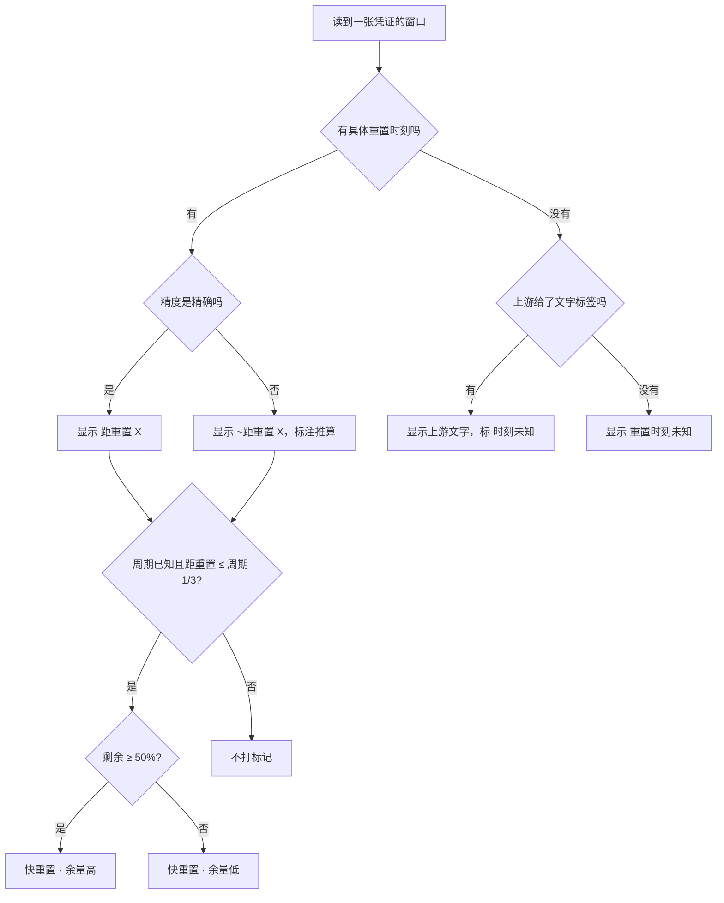
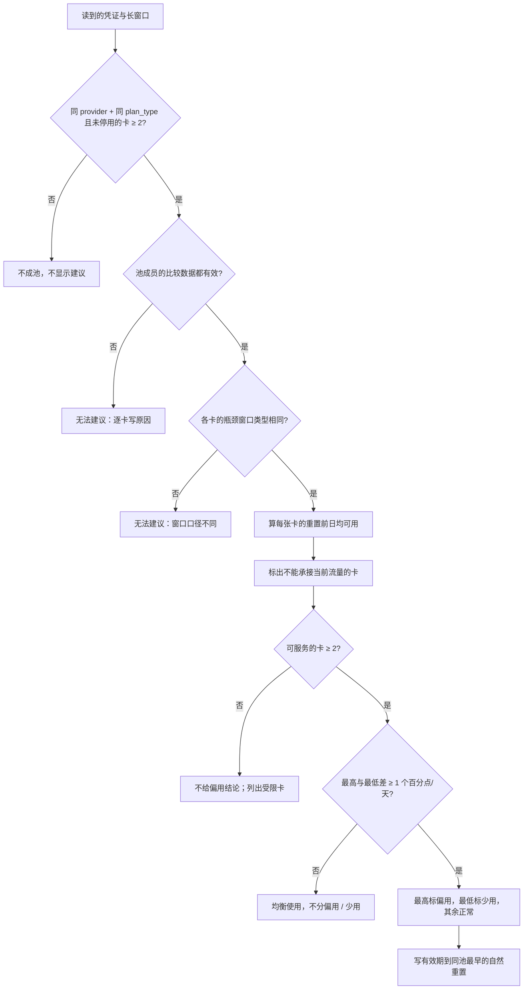
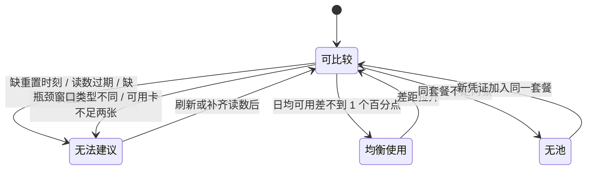

# PRD：跨凭证额度拆借（显示层与建议层）

状态：待评审
日期：2026-11-23
来源：2026-11-23 需求原话（T7 切片 S2）、同交付目录 `research.md`（T7-S1 调研）、控制台与额度现状的只读核对

## 1. 背景与目标

两台 Codex Pro 200 凭证的周限额不同步：A 还剩 88%，11/27 才自然重置；B 只剩 40%，11/25 就自然重置。现在的控制台能看到每张卡的剩余百分比，也能在每个窗口下面看到一句重置倒计时，但看不出「谁该多用、谁该省着用」：两张卡都是合法路由目标，凭感觉分配流量，B 很可能在回满前先耗尽，A 又撑不到 11/27。

正确的用法不是平均分，也不是只看剩余百分比，而是按「谁离自然重置更远、相对余量更宽裕」排优先级：这两天偏用 A、少用 B，把 B 的 40% 留到 11/25 回满；之后按同样的口径重算，角色由当时的余量和重置时间决定。

**目标**：让运营人员在同一份数据上同时看到「每张卡离自然重置还有多久」和「同池凭证里先偏用谁、少用谁、为什么」；这份建议只读、可解释、数据不全时明确停手，并放在独立的额度拆借页，不挤占凭证列表。

**成功标准**：

- 不打开凭证详情，就能在列表行看到每个窗口的剩余百分比、距自然重置的倒计时和「快重置 · 余量高 / 低」标记。
- 能把列表按「距自然重置最近」排序，一眼分出「快重置但额度还高」和「快重置且额度低」。
- 同 provider、同套餐的两张以上凭证在独立的额度拆借页出现一条跨卡建议，写明偏用谁、少用谁、依据的读数时刻、每张卡的数字和建议有效期。
- 缺重置时刻、读数过期、窗口口径不同、可用卡不足时，建议显示「无法建议」及逐卡原因，不猜、不退回只按剩余百分比排序。
- 建议只读：页面上没有任何写入 CPA 路由、消耗重置权益的动作。

> [!注意] 本文的 4 个待确认
> q01 路由权重（4.9）、q02 建议窗口范围（4.4）、q03 比较口径（4.5）、q04 快重置标记（4.2）。评审页页首可以逐条点选；整页不看或全部不选时按推荐定稿。

## 2. 用户与场景

| 角色 | 场景 | 关心什么 |
|---|---|---|
| 运营人员 | 早上打开凭证列表，决定今天哪张卡多承接流量 | 每张卡离自然重置还有多久；同套餐里先偏用谁、少用谁；理由是否可信 |
| 值班人员 | 某张卡余量快速下降，临时调整用法 | 快重置的卡还剩多少、会不会在回满前耗尽；建议的有效期到什么时候 |
| 负责额度成本的人 | 判断跨卡建议值不值得照着做 | 建议依据的读数时间、重置精度、数据不全时会不会乱给 |

## 3. 范围

### 做

- 显示层：列表行强化「距自然重置还有多久」，新增快重置标记，新增按距自然重置排序。
- 建议层：同 provider + 同套餐的凭证组成可拆借池，给出偏用 / 少用 / 均衡的只读建议、理由和有效期。
- 建议层的数据不全降级：逐卡写原因，明确「无法建议」。
- 独立二级页、列表页入口摘要与凭证详情三处展示同一份池建议，并写清与现有单卡重置权益建议的区别。

### 不做

- 不写 CPA 的 priority / weight，不做自动路由、自动切凭证、自动停用（是否落路由权重见 4.9 的待确认 q01）。
- 不改现有单卡重置权益建议的语义、阈值、位置和动作。
- 不消耗 Codex 重置次数 / Claude 重置授权，不新增上游采集，不新增通知。
- 不覆盖 5 小时、滚动、模型级、分组级窗口的建议；这些窗口只在单卡行里照常展示。
- 不做「按模型可用性筛选池」、不做跨 provider 拆借、不做历史趋势曲线。

## 4. 功能需求

### 4.1 口径与术语

先把判断用的词定死，后面所有界面、数字和建议都用这一套。

| 术语 | 定义 | 判不准时 |
|---|---|---|
| 自然重置 | 额度窗口按自身周期回满的时刻；只认读数里的具体时刻，精确或推算都算，只有文字不算 | 显示上游文字并标「时刻未知」，不换算、不猜时刻 |
| 可拆借同池 | 同 provider + 同 plan_type 的多张凭证；至少两张有可比较的长窗口读数 | plan_type 缺失或未知 → 不进池，在面板底部计入「未参与」 |
| 长窗口 | 凭证自己的标准窗口，周期 ≥ 24 小时（日 / 周 / 月） | 周期未知 → 不算长窗口，不参与建议 |
| 建议窗口 | 一张卡所有长窗口中剩余百分比最低的那个；同池各卡的建议窗口类型相同才可比较 | 类型不同 → 「无法建议：窗口口径不同」，不跨类型比较 |
| 重置前日均可用 | 剩余百分比 ÷ 距自然重置的天数，单位「%/天」；距重置不足 1 小时按 1 小时算 | 缺剩余或重置时刻 → 该卡不可参与比较 |
| 有效读数 | 沿用现有额度鲜度界：至少 2 小时，长窗口按周期的 1/4，最多 24 小时 | 超过 → 该卡「读数过期」，不参与比较 |
| 快重置 | 距自然重置不超过窗口周期的 1/3 | 周期未知 → 不打标记 |
| 余量高低 | 剩余 ≥ 50% 为高，< 50% 为低 | 剩余缺失 → 只打「快重置」或「时刻未知」，不硬分高低 |
| 可服务 | 没有已耗尽且未重置的标准窗口，不在 CPA 冷却、不需要重新授权、不是停用状态 | 不可服务 → 不参与偏用排名，其他卡照常比较 |

> [!决策] 同池 = 同 provider + 同 plan_type
> 调研确认现成的可比键只有 provider 和套餐；套餐不同则模型访问范围、额度规模和重置周期都可能不同，不能互相替代。`type` 不再细分：能发布窗口读数的凭证已经有共同的可观测口径，再按 OAuth / API key 分池会把同一套餐的卡拆散。同一账号下的多张凭证不互相拆借：读数会完全相同，日均可用自然落进「均衡」，不会给出错误偏用；如能确认是同一账号，直接排除在池外。
>
> 判不准时宁可少建议：plan_type 未知就不进池，不按 provider 把不同套餐硬凑在一起。

> [!决策] 只比较长窗口
> 5 小时窗口重置太快，拿它排「撑到重置」的优先级会来回跳；模型级和分组级窗口口径不同，不能放在一张表里比。日 / 周 / 月窗口才是「省额度、等回满」有意义的对象。短的 5 小时窗口照常显示倒计时和快重置标记，只是不参与跨卡建议。

> [!注意] 建议不改变现有额度状态
> 拆借建议只读：它不刷新额度、不清冷却、不换凭证、不改单卡状态，也不影响现有的额度预测和告警。页面上看到的数字和没有这个功能时完全一致，多出来的只是比较和结论。

### 4.2 显示层：单卡的重置倒计时与标记（主流程）

现有的行内已经有「重置倒计时」，但它只是进度条下面的一行小字，没有标签、没有排序，也没区分「快重置时余量高还是低」。本版把它强化成一眼可读的信息，不改变数据本身。

图：一次额度读数怎么变成行内倒计时与标记


规则：

- 每个有读数的窗口都显示「距重置 X」，X 按分钟 / 小时 / 天显示；有具体时刻的同时显示日期。重置时刻是推算或近似的，数字前带 `~`，鼠标悬停能看到完整时刻和精度说明。
- 只有上游文字、没有具体时刻的窗口保留原文（例如「11 月 27 日下午」），并标「时刻未知」；不把文字换算成假时刻，也不显示倒计时。
- 距重置 ≤ 窗口周期的 1/3 时打「快重置」标记；剩余 ≥ 50% 显示「快重置 · 余量高」，< 50% 显示「快重置 · 余量低」。同一张卡的不同窗口可以一个高一个低，标记跟着窗口走，不汇总到卡上。
- 标记只用文字和颜色，不只用颜色；颜色语义沿用现有状态色：余量高用信息色，余量低用注意色。

```screen 01-凭证列表-重置倒计时与排序.html
编号 | 名称 | 说明 | 对应 AC
1 | 额度拆借入口 | 页头统计行末尾的链接，有偏用时写「额度拆借 · N 条建议」，只跳转，不占独立区块 | AC-9、AC-12、AC-14b
2 | 额度拆借页的池标题与有效期 | 写明 provider · 套餐 · 窗口类型、几张可拆借、建议有效到哪个自然重置时刻 | AC-5、AC-6、AC-9
3 | 额度拆借页的偏用 / 少用 | 每张卡一行：角色、凭证名、剩余百分比、距重置天数、重置前日均可用；角色只用偏用 / 少用 / 均衡 / 正常四种 | AC-7、AC-8、AC-9
4 | 额度拆借页的理由句 | 一句话说清谁更快重置、谁更宽裕，数字和上面三列一致 | AC-9、AC-11
5 | 排序选项 | 「距自然重置最近」是新增排序；选它后按每张卡最早的长窗口自然重置时刻升序，短的 5 小时窗口不参与 | AC-3、AC-4
6 | 凭证行 | 行里同时给出剩余百分比、进度条和距重置倒计时；没有读数的行说明缺哪种读数 | AC-1
7 | 单窗口倒计时 | 每个窗口单独一行「距重置 X」；推算 / 近似时刻带 ~，只有文字时保留上游文字并标时刻未知 | AC-1、AC-16
8 | 未进池汇总 | 额度拆借页的「未进池」区汇总数量与原因计数；凭证名明细默认折叠，避免无声跳过 | AC-5、AC-14、AC-14c
9 | 快重置标记 | 距重置 ≤ 周期 1/3 时出现「快重置 · 余量高 / 低」；同一张卡的不同窗口可以一个高一个低 | AC-2
```

> [!待确认] q04 快重置标记的判定：距重置 ≤ 窗口周期的 1/3，余量以 50% 分高低？
> 现在按这个规则画（AC-2）。
> - 按窗口周期的 1/3，余量 50%（推荐）：周窗口约 56 小时、日窗口约 8 小时、5 小时窗口约 1.7 小时，跨窗口类型都能用；50% 是「一半余量」的直观分界
> - 固定 72 小时，余量 50%：规则更好解释，但月窗口会提前 3 天就标「快重置」，5 小时窗口永远不会标
> - 只打「快重置」、不分余量高低：更简单，但看不出「快重置且额度低」和「快重置但额度高」的区别

### 4.3 显示层：按距自然重置排序

- 排序选项新增「距自然重置最近」，和其他排序并列放在列表筛选里。
- 排序键取每张卡所有**标准长窗口**中最早的自然重置时刻，按升序排：快到重置的在前，离重置远的在后。
- 没有长窗口、没有重置时刻的卡排在最后，不参与比较；短窗口（5 小时、滚动等）不参与排序键。
- 同一时刻或都未知时，按剩余百分比低者在前（更可能需要处理），再按名称排，保证每次排列稳定。
- 选择会像其他排序一样被记住，下次打开保持；点「重置筛选」回到默认的名称排序。

> [!注意] 排序和排序键不是一回事
> 行里可能同时有 5 小时和周两个窗口，但排序只看长窗口——否则一张 5 小时窗口还剩 20 分钟的卡会永远排第一，而运营真正要比较的是周窗口的余量和重置时间。短窗口的快重置标记照常显示，只是不决定顺序。

### 4.4 建议层：同池偏用建议（主流程）

建议层的输入就是列表页已经加载的那批凭证和额度读数，不额外向上游请求；输出是一段可解释的只读结论。

图：同池建议从分组到给出结论


默认展示规则：

- 面板按池显示，一个池一行标题加每张卡一行；池按「最早的自然重置」从近到远排，最紧迫的池排最前。
- 每张卡一行：角色、凭证名、建议窗口的剩余百分比、距自然重置、重置前日均可用。角色只有偏用 / 少用 / 均衡 / 正常四种；「无法建议」是池级状态，逐卡只写原因，不硬塞角色。
- 理由句只回答两件事：谁更快自然重置、谁相对更宽裕；数字必须和三列一致，不写没有依据的判断。
- 有效期写到同池最早的自然重置时刻；到点后按新读数重算，角色可能保持也可能互换，由当时的余量和重置时间决定，不承诺「回满就一定翻盘」。

```screen 02-拆借建议-三种状态.html
编号 | 名称 | 说明 | 对应 AC
1 | 建议块标题 | 标题旁写「只提示，不改路由」；下面写依据的读数时刻和会随页面时钟重算 | AC-9、AC-12
2 | 池标题与状态 | 有建议时写「N 张可拆借」和有效期；无法建议时写「N 张，无法建议」；池按最紧迫的排前面 | AC-5、AC-6、AC-9、AC-10
3 | 角色与凭证 | 偏用 / 少用 / 均衡；无法建议是池级状态，不勉强给偏用，逐卡列原因 | AC-7、AC-8、AC-10
4 | 三列数字 | 剩余 %、距重置天数、重置前日均可用；数字缺失写「—」不写 0 | AC-7、AC-9
5 | 理由句 | 说清「谁更快重置、谁更宽裕」；有效期以同池最早的自然重置为准 | AC-9、AC-11
6 | 推算标记 | 重置时刻来自推算或近似时带 ~，整条建议标「参考」；差值在门槛内按均衡处理 | AC-11
7 | 无法建议的原因 | 逐卡写具体原因：缺重置时刻、读数过期、缺长窗口、瓶颈窗口不同、可用卡不足两张；不退回按剩余百分比猜 | AC-10
8 | 无同池空状态 | 写清同池条件，并给未参与的数量分解；不是所有凭证都能拆借 | AC-5、AC-14
9 | 只读说明 | 没有应用按钮；不写 priority / weight，不消耗重置次数或授权 | AC-12
```

> [!待确认] q02 建议层只覆盖周期 24 小时以上的标准窗口吗？
> 现在按「只覆盖长窗口」画（AC-6）。
> - 只覆盖长窗口（推荐）：5 小时窗口自愈太快，拿它排优先级会来回跳；日 / 周 / 月窗口才值得排「撑到重置」
> - 所有标准窗口都参与：覆盖更全，但同池里 5 小时窗口的重置时间差一两个小时就会翻转建议，噪声大
> - 只覆盖周窗口：最贴近这次两台 Codex Pro 200 的场景，但日 / 月窗口的池永远得不到建议

### 4.5 建议层的判定口径

对每张可参与比较的卡，算「重置前日均可用」：

**重置前日均可用 = 剩余百分比 ÷ 距自然重置的天数**（距重置不足 1 小时按 1 小时算，结果保留一位小数）

主轴仍然是自然重置时刻：每张卡的比较都以它自己的下一次自然重置为终点，剩余百分比只表示「到那个终点还剩多少」。它回答的是「这张卡在回满前每天最多能承接多少」，不是「现在剩多少」。两张卡的重置时刻不同，光比剩余百分比会把「快重置、余量低」的卡误判成更穷；光比重置时间又会把「快重置、余量高」的卡不必要地少用。

| 场景 | A 卡 | B 卡 | 日均可用 | 建议 |
|---|---|---|---|---|
| 本次两台 Codex Pro 200 | 剩 88%，3.9 天后重置 | 剩 40%，2.3 天后重置 | A 22.6，B 17.6 | 偏用 A、少用 B：B 的 40% 先保住，等 11/25 回满 |
| 快重置但余量高 | 剩 30%，4 天后重置 | 剩 95%，1 天后重置 | A 7.5，B 95 | 偏用 B：B 明天就回满，今天用它不会伤到重置前的余量 |
| 快重置但余量低 | 剩 5%，30 天后重置 | 剩 80%，2 天后重置 | A 0.2，B 40 | A 低于 10% 门槛、不参与比较；只剩 B 一张，不给偏用结论，A 留作应急 |
| 两张差不多 | 剩 60%，4 天后重置 | 剩 58%，4 天后重置 | A 15.0，B 14.5 | 均衡使用：差值不到 1 个百分点/天，不值得特意偏 |

判定顺序：

1. 停用的凭证不计入池；池成员不足两张时不成池、不显示建议。
2. 池成员的比较数据有任一无效（缺建议窗口、缺重置时刻、读数过期）或建议窗口类型不同时，整池「无法建议」，逐卡写原因。未知的卡可能是最宽裕的那张，不能假装它不存在。
3. 数据都有效时，算每张卡的日均可用，并标出不能承接当前流量的卡：冷却中、需要重新授权、读取失败、已耗尽、有标准窗口耗尽且未重置、剩余低于 10%。这些卡不参与偏用排名，但要在原因里逐张列出。
4. 可服务的卡按日均可用从高到低排：最高的标「偏用」，最低的标「少用」，中间标「正常」。
5. 若最高与最低的差小于 1 个百分点/天，全部标「均衡使用」，不给偏用 / 少用；差值达到 1 个百分点/天才分先后。
6. 可服务的卡不足两张时，不给偏用结论；把受限卡、原因和它们各自的距离写出来。

> [!决策] 用「重置前日均可用」而不是只看剩余百分比
> 剩余百分比高不代表这几天更宽裕：一张 70% 但 30 天后才重置的卡，每天只能用 2.3%；一张 40% 但 2 天后就回满的卡，每天能用 17.6%。日均可用把重置时间放进分母，既尊重「谁快重置谁先回满」的直觉，又能处理「快重置但余量很高」的反例。纯按重置时刻从晚到早排会把「明天重置、还剩 95%」的卡不必要地少用；纯按剩余百分比排则正是这次要避免的平均主义。

> [!待确认] q03 同池偏用顺序按「重置前日均可用」还是按「重置时刻从晚到早」？
> 现在按「重置前日均可用」画（AC-7、AC-8）。
> - 重置前日均可用 = 剩余% ÷ 距重置天数（推荐）：同时看余量和重置时间；本案例 A 22.6%/天、B 17.6%/天，偏用 A，且每张卡都能算出撑到重置的节奏
> - 纯按重置时刻从晚到早：最贴近「谁快重置就少用」的原话，但遇到「明天重置、还剩 95%」的卡会白白少用，遇到「30 天后重置、只剩 5%」的卡会被门槛挡住
> - 只按剩余百分比从高到低：最简单，但正是这次要避免的算法——A 的 88% 会永远压过 B 的 40%，不看谁先重置

### 4.6 建议层的数据不全与降级

图：一个同池建议的几种状态


| 情况 | 显示 | 运营人员下一步 |
|---|---|---|
| 缺重置时刻（只有文字） | 该卡「重置时刻未知」，整池「无法建议」 | 等上游给出具体时刻，或核对凭证的额度读取是否正常 |
| 读数过期 | 该卡「读数已过期，最后读数在 N 小时前」 | 刷新该卡额度，等新读数 |
| 缺长窗口 / 没有剩余百分比 | 该卡「没有可比较的长窗口」 | 核对凭证是否发布了日 / 周 / 月窗口 |
| 剩余低于 10% | 该卡「余量低于 10%，不参与偏用排名」；其他可服务的卡照常比较 | 等刷新或重置后再看；这张卡留作应急 |
| 冷却中 / 需要重新授权 / 读取失败 | 该卡「暂不可承接流量」，不参与偏用排名；其他可服务的卡照常比较 | 处理该卡的状态，或等冷却结束 |
| 已耗尽 / 某标准窗口耗尽且未重置 | 该卡「当前无可用余量」，不参与偏用排名 | 等重置或补额度 |
| 各卡瓶颈窗口类型不同 | 整池「窗口口径不同」并列出每张卡的窗口类型 | 分别看单卡；等出现同类型窗口再比较 |
| 可服务的卡不足两张 | 整池「无法给出偏用结论」，列出受限卡和原因 | 处理受限卡（刷新、等冷却、重新授权） |
| 同套餐只有一张 | 不显示池，计入底部「未参与」 | 正常情况，不需要处理 |

> [!注意] 「无法建议」不是「均衡使用」
> 均衡是「比较过，差别不大」；无法建议是「压根没得比」。两者不能共用文案，也不给偏用结论。读数过期、缺时刻、窗口口径不同都不能降级成「按剩余百分比排」——那正是这次要避免的算法。

> [!注意] 本节只写降级，不重复口径
> 比较口径见 4.5（q03），窗口范围见 4.4（q02）；这里只列数据不全时怎么显示、下一步做什么。

### 4.7 建议在哪里出现：额度拆借页、列表页入口与凭证详情

同一份池建议在三处出现，数字、理由、有效期必须一致：

- **独立二级页 `/quota-lending`（额度拆借页）**：所有池的完整建议，先给「最紧迫的池」，运营人员不进详情就能照着做；池多时按最早重置排序，保证最紧迫的池先出现。路径与菜单文案集中在挂载模块 `web/src/types/quotaLendingMount.ts`，侧栏高亮落在「能力 › 额度拆借」这条自身条目上；页头有「返回上一页」链接（直接打开二级页时不显示）；页面是一列区块的结构，为二期的多窗口、订阅截止、将断档、自动化确认留位置，一期不画空占位。
- **凭证列表页（`/oauth-management`）的页头统计行**：只多一个很轻的入口链接，按 `lending` 的池状态显示「额度拆借 · N 条建议」「额度拆借 · 均衡」或「额度拆借」；`lending` 字段缺失时不显示。入口不占独立区块，不增加页面纵向高度；点击进入额度拆借页。
- **凭证详情的额度页**：这张卡属于哪个池、当前角色、同池还有谁、同一句理由和有效期。它回答的是「这张卡在池里处于什么位置」，不是另一份独立建议；下面给一个「在额度拆借页查看整池」的链接，不复制整池表格。
- 如果这张卡不在任何池里，详情页写原因：套餐未知、同套餐不足两张、没有长窗口、读数不可用；不显示空白的「建议」区块。

「未进池」的凭证不在池块里展开：额度拆借页用默认折叠的「未进池」区展示，收起时只显示总数与按原因分组的计数，展开后按原因分组，每组再展开才列凭证名。

```screen 03-凭证详情-拆借说明.html
编号 | 名称 | 说明 | 对应 AC
1 | 拆借建议区块 | 详情抽屉的额度页先给这张卡的池角色；和列表页同源同数字；无法建议时给原因 | AC-9、AC-13、AC-15
2 | 池归属 | 写明它属于哪个池、同套餐几张、当前角色；不在任何池时写原因（套餐未知 / 同套餐不足两张） | AC-5、AC-15
3 | 依据与有效期 | 与列表页同一句理由、同一读数时刻、同一有效期；无法建议时列出缺什么 | AC-9、AC-10、AC-15
4 | 窗口倒计时 | 每个窗口的剩余与距重置；推算 / 近似带 ~，只有文字时标时刻未知 | AC-1、AC-16
5 | 重置权益建议 | 原有单卡「要不要用掉重置次数 / 授权」的建议，位置和语义不变 | AC-13
6 | 区别说明 | 一句固定说明：拆借建议看自然重置前的用法，重置权益建议看到期时间；两者不互相替代 | AC-13
```

### 4.8 与单卡重置权益建议的关系

现在的「重置权益建议」回答的是另一件事：Codex 的重置次数、Claude 的重置授权要不要在到期前用掉。它只看一张卡、只覆盖 codex / claude、要求 2 小时内的权益读数，不比较其他凭证。本版新增的拆借建议看的是自然重置前的流量分配，不碰重置权益。两者必须分开。

| 维度 | 拆借建议（本版新增） | 重置权益建议（原有，不改） |
|---|---|---|
| 回答 | 接下来偏用哪张卡、少用哪张 | 要不要在到期前用掉重置次数 / 授权 |
| 数据 | 窗口剩余百分比、自然重置时刻、读数鲜度 | 重置次数 / 授权的余额和到期时间，2 小时内的权益读数 |
| 范围 | 同 provider + 同套餐的池 | 单卡；只覆盖 codex / claude |
| 输出 | 偏用 / 少用 / 均衡 / 无法建议 | 到期前用掉 / 留给恢复 / 不用管 / 证据不足 |
| 动作 | 无，纯只读 | 有消耗重置权益的既有动作，位置和语义不变 |

> [!决策] 不合并两种建议
> 合并会让「省额度」和「用掉权益」两个相反的动作出现在同一个结论里，运营人员分不清该不该点；也会把只覆盖 codex / claude 的权益口径扩散到所有 provider。两套文案、两个位置、两套数据，各自回答各自的问题。

### 4.9 路由权重：本期不做，待确认

调研确认 priority / weight 是 CPA 的调度字段：高 priority 先被选中；weight 只在加权轮询且同优先级内生效，0 会把凭证排除在外；fill-first / round-robin 忽略 weight；已有的会话可能仍绑定在原凭证上。改它确实会让线上所有请求的走向发生变化，而项目边界是「不做自动路由，不进 CPA 请求路径」。所以本版只做提示，是否再往前走一步由 q01 决定。

| 路径 | 做什么 | 后果 | 与项目边界的关系 | 本版 |
|---|---|---|---|---|
| 只提示 | 控制台展示偏用 / 少用 | 对线上零影响；照建议做仍靠人 | 不触碰边界 | 做 |
| 人工确认后写 priority / weight | 给一个「按建议调整」的受控动作 | 影响线上所有请求；策略、权重和会话亲和可能让效果打折；需要回滚和审计 | 不是自动路由，但改的是线上调度，要单独立项 | 不做，等 q01 |
| 按建议自动写 | 持续按建议改权重 | 等于把建议变成自动路由 | 越过边界 | 不做 |

> [!待确认] q01 是否把拆借建议落成 CPA 的路由权重（priority / weight）？
> 现在按「只提示」画（AC-12、AC-17）。
> - 只提示，不改路由（推荐）：不越项目边界，对线上请求零影响；代价是照建议做仍要人工调流量或改权重
> - 本期再提供「人工确认后写入 priority / weight」：能让路由自动偏置，但改的是线上所有请求，要额外设计回滚、策略兼容和会话亲和的影响，属于本期范围外的新能力
> - 按建议自动、持续写权重：最省人工，但等于做了自动路由，直接越过「不做自动路由，不进 CPA 请求路径」的边界

> [!风险] weight 不保证按建议生效
> 如果 CPA 用 fill-first 或 round-robin，weight 不参与选择；如果会话已经绑定到某张凭证，priority / weight 也不会立刻改道。即便未来决定写权重，也只能当「偏置」而不是「保证」。

## 5. 验收标准

- **AC-1** 每张凭证的每个有读数的窗口，行内显示剩余百分比和「距重置 X」倒计时；没有读数的行说明缺的是哪种读数；有具体重置时刻才显示倒计时，只有文字时保留上游文字并标「时刻未知」；推算或近似时刻带 `~`。
- **AC-2** 距重置不超过窗口周期 1/3 的窗口带「快重置」标记；剩余 ≥ 50% 标「余量高」，< 50% 标「余量低」；周期未知时不打标记；标记以文字表达，不只靠颜色。
- **AC-3** 排序新增「距自然重置最近」，按每张卡所有标准长窗口中最早的自然重置时刻升序排；没有长窗口或没有重置时刻的排最后；短窗口不参与排序；同刻按剩余百分比低者在前，再按名称。
- **AC-4** 「距自然重置最近」与其他排序一样被记住，刷新后保持；点「重置筛选」回到名称排序。
- **AC-5** 同池只由同 provider + 同 plan_type 的凭证组成；plan_type 缺失或未知的凭证不进任何池；同套餐不足两张时不显示池；未参与池的凭证数量和原因在额度拆借页的「未进池」区汇总，数量与原因分组计数始终可见，凭证名明细默认折叠。
- **AC-6** 只有标准且周期 ≥ 24 小时的窗口参与建议；每张卡取剩余百分比最低的长窗口作为建议窗口；同池各卡的建议窗口类型不同时不给偏用建议。
- **AC-7** 重置前日均可用 = 剩余百分比 ÷ 距重置天数（不足 1 小时按 1 小时）；最高者标「偏用」，最低者标「少用」；最高与最低差小于 1 个百分点/天时全部标「均衡使用」，不分偏用 / 少用。
- **AC-8** 停用的凭证不计入池；冷却中、需要重新授权、读取失败、已耗尽、有标准窗口耗尽且未重置、剩余 < 10% 的卡不参与偏用排名；可服务的卡不足两张时不就偏用给结论，但要列出受限卡和原因。
- **AC-9** 额度拆借页的池块显示有效期（同池最早的自然重置时刻）、每张卡的建议窗口、剩余百分比、距重置、日均可用和一句理由；理由说清谁更快重置、谁更宽裕，数字与三列一致。
- **AC-10** 缺重置时刻、读数过期、缺长窗口、建议窗口类型不同时，额度拆借页的该池显示「无法建议」并逐卡写原因；可服务的卡不足两张时不给偏用结论并列出受限卡；不得退回只按剩余百分比给建议。
- **AC-11** 重置时刻为推算或近似时，额度拆借页照常给建议但带 `~` 并标「参考」；差值落在门槛内时按均衡处理。
- **AC-12** 建议只读：额度拆借页与列表页入口同样没有应用、写入、切换路由、消耗重置权益的按钮；入口只是跳转链接，不改变 CPA 配置和线上请求走向。
- **AC-13** 原有单卡重置权益建议的语义、位置、阈值和动作不变；拆借建议整块在额度拆借页，单卡重置权益建议仍在凭证详情原位，两者不在同一块区域，文案不混用；拆借建议不提重置次数 / 授权，重置权益建议不提偏用 / 少用。
- **AC-14** 无同池或全部不可比较时，额度拆借页显示空状态并说明原因；未参与池的凭证数量和原因在「未进池」区汇总，不无声跳过。
- **AC-14a** 额度拆借页：路径为 `/quota-lending`（以挂载模块 `web/src/types/quotaLendingMount.ts` 为准），标题沿用「额度拆借建议」，页头有「返回上一页」链接（用浏览器历史，直接打开二级页时不显示）；侧栏高亮落在「能力」组的额度拆借条目上（由该条目自己决定）；直接打开、刷新、浏览器前进后退都可用；旧后端没有 `lending` 字段或读取失败返回 `null` 时显示降级空状态，不白屏。
- **AC-14b** OAuth 页入口：不再渲染建议面板；入口是页头统计行末尾的链接（不是按钮、不占独立区块、不增加页面纵向高度），有偏用建议时写「额度拆借 · N 条建议」，有池且都为均衡时写「额度拆借 · 均衡」，无池或都无法建议时只写「额度拆借」；`lending` 字段缺失或为 `null` 时不显示入口；点击进入额度拆借页。
- **AC-14c** 「未进池」区默认折叠：收起时只显示总数和按原因分组的计数；展开后按原因分组，每组再展开才列出凭证名；数量与各原因计数和后端返回一致，不丢不重；N=0 时整区不显示。
- **AC-15** 额度拆借页、OAuth 页入口摘要和凭证详情三处使用同一份 `lending` 数据；入口的条数，详情里的角色、数字、理由、有效期，都与额度拆借页一致；详情能看出该卡属于哪个池，或为什么不在任何池；没有 `lending` 时凭证详情不显示建议块。
- **AC-16** 所有时间按控制台现有生效时区显示；倒计时随页面时钟推进更新，建议随页面时钟重算，额度拆借页同样适用，不额外请求上游。
- **AC-17** 不改变现有额度采集、预测、单卡状态和通知；建议不落库、不推送、不产生新的历史记录。（非界面）

## 6. 非功能需求

- **性能**：建议只用额度概览已经加载的凭证和读数计算，不新增逐卡请求；页面加载和刷新额度的行为不变。
- **时区**：所有时刻沿用控制台生效时区，倒计时和日期使用同一时区；跨时区查看时数字不漂移。
- **可访问性**：状态和标记用文字加颜色，不只靠颜色；窄屏（≤ 760px）时额度拆借页与入口摘要、凭证行改为单列，不横向滚动。
- **兼容**：旧网关或旧凭证没有 plan_type 时，退化为「套餐未知、不进池」，不报错、不隐藏凭证；没有长窗口的 provider 只显示单卡信息。
- **数据**：建议不落库、不推送、不产生新的历史记录；关闭页面即结束，下次打开按最新读数重算。
- **权限**：整个功能只读；不新增写 CPA 配置、写凭证字段、消耗重置权益的入口。

## 7. 风险与待定

> [!风险] 重置时刻是推算值时，临界判断可能翻转
> Codex 只有「距现在多少秒」时，重置时刻是推算值；读数刷新后可能前后移动几个小时。缓解：行内和池内都带 `~` 和「参考」，日均可用差不到 1 个百分点/天按均衡处理，不把临界值说成确定结论。

> [!风险] 同套餐不等于同模型可用性
> 两张同套餐凭证的模型访问范围可能不同；偏用 A 时某个模型可能只有 B 有。缓解：建议只表达流量偏好，不替代 CPA 的可用性判断；请求仍会落到能服务该模型的凭证上。若这种情况反复出现，再考虑把模型可用性纳入池口径（本期不做）。

> [!风险] 同一账号的多张凭证看起来像两张卡
> 同一上游账号重复登记时，两张卡的读数和重置时刻可能完全相同，日均可用会落进「均衡」，不会给出错误偏用；如能确认是同一账号，直接排除在池外。判不准时按不同卡参与比较，并在风险里记录。

> [!风险] 建议被误读成「已经改了路由」
> 控制台出现偏用 / 少用后，运营人员可能以为请求已经自动偏向 A。缓解：建议块固定写「只提示，不改路由」；没有任何应用按钮；若 q01 选择写入权重，另立项目并重新设计文案和审计。

> [!风险] 短窗口耗尽但长窗口仍宽裕
> 一张卡的周窗口还很宽裕、5 小时窗口却已耗尽，此刻它并不能承接请求。缓解：可服务门槛把「有标准窗口耗尽且未重置」的卡排除在偏用之外，并在原因里写清是哪个窗口。

> [!风险] 池建议与单卡状态不同步
> 建议按页面时钟重算，但额度读数本身有鲜度界；读数过期后建议必须退成「无法建议」，不能继续用旧数据给偏用结论。缓解：鲜度界与现有额度预测一致，过期即降级。

本节的待确认：q01（路由权重）、q02（建议窗口范围）、q03（比较口径）、q04（快重置标记），都在对应小节里点选；页首会自动汇总。

## 8. 版本记录

- v0.1（2026-11-23）：首版。按 T7-S2 的任务说明与 T7-S1 调研报告，定显示层、建议层和路由权重的待确认；原型三屏，待确认四题。

## 9. 后续任务

- 评审：运营人员在评审页上对三屏和三态给结论，重点点选 q01–q04；有疑问的地方直接在节、图、屏或元素上评论。
- 定稿后：按 AC-1 至 AC-17 拆分工作包，先做显示层（倒计时、标记、排序），再做建议层的池计算和降级，最后接额度拆借页、列表页入口与详情页。
- 验收准备：按 AC 写用例时，至少覆盖两张同套餐卡、快重置高低余量、缺重置时刻、读数过期、窗口口径不同、同套餐只有一张六种数据形状。
- 后续评估：是否把模型可用性纳入池口径；是否把建议沉淀成可回看的历史；是否在 q01 决定后另立路由权重项目。

## 10. 变更记录

- 2026-11-23 17:54 — 浩文看完一期体验环境（`/omc/oauth-management?page_size=48`）后要求：拆借建议改到独立的二级页，OAuth 登录页内容太多。本版把建议整块搬到 `/quota-lending`，OAuth 页只留页头入口；二期要加的多窗口、订阅截止、将断档、自动化确认也落在这一页。这是 T7 同一件需求的范围调整，不是新需求。
- 2026-11-23 18:19 — 导航将新增「能力」栏目（另一项需求，由另一位 PM 出方案）；额度拆借页的挂载点改为独立配置 `web/src/types/quotaLendingMount.ts`，路径 `/quota-lending`，菜单位置待那项需求定，本期不新增侧栏菜单项。
- 2026-11-23（审查后）— 一期审查的两条后端口径偏差已修复（受限池可服务卡为中性角色；不可比较池不给有效期）；快照或冷却读失败时总览与详情的 `lending` 为空，前端按字段缺失同样降级。

| 原条目 | 调整后 |
|---|---|
| AC-5、AC-14 | 「未参与池的凭证数量和原因在空状态或面板底部汇总」→ 在额度拆借页「未进池」区汇总，数量与原因分组计数始终可见，凭证名明细折叠。 |
| AC-9、AC-10、AC-11 | 建议块的内容不变，位置改为额度拆借页的池块。 |
| AC-12 | 只读范围扩到额度拆借页与入口；入口只是跳转链接。 |
| AC-13 | 拆借建议整块在额度拆借页，单卡重置权益建议仍在凭证详情原位；两者不在同一块区域，文案不混用。 |
| AC-15 | 「列表页和凭证详情展示同一份池建议」→ 额度拆借页、OAuth 页入口摘要、凭证详情三处用同一份 `lending` 数据；入口的条数、详情的角色/数字/理由/有效期与额度拆借页一致。 |
| AC-16 | 倒计时随页面时钟推进、建议随页面时钟重算，额度拆借页同样适用。 |
| 新增 AC-14a | 额度拆借页：路径由挂载模块决定、标题、返回上一页（直接打开时不显示）、侧栏高亮落在「能力」组的额度拆借条目上、直接打开/刷新/前进后退、旧后端降级空态。 |
| 新增 AC-14b | OAuth 页入口：不再渲染面板；入口三态 + 缺字段不显示；不增加页面纵向高度；点击进额度拆借页。 |
| 新增 AC-14c | 未进池折叠：默认折叠、摘要按原因分组计数、展开按原因分组列凭证名、计数与后端一致。 |
