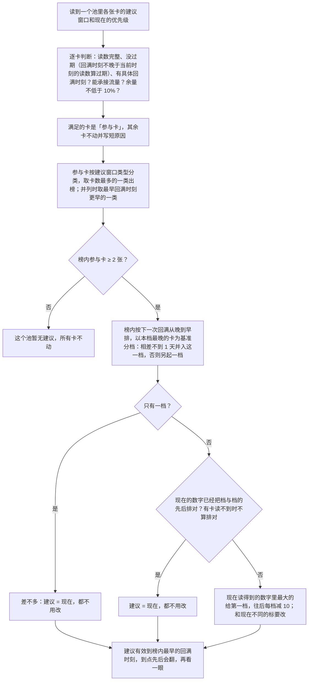
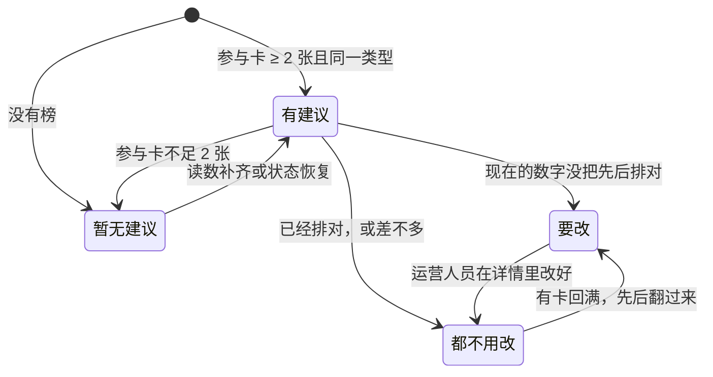

# PRD：额度拆借页改版（一期增量）

状态：定稿（D1～D5 五项决定均已定，见第 5.12 节）
日期：2026-11-26
基线：一期 PRD（交付目录 2026-11-23-omc-quota-lending 里的 prd 文档）。一期验收标准的编号保持不变，本文用「沿用 / 改写 / 新增」标注，新增从 AC-18 起编。
配套：同目录的需求要点文档（原话、现状核实、范围、决定）、调研报告（CPA 优先级怎么起作用，下文「调研报告」指它）、大白话评审页（下文「评审页第 N 屏」指它；每项决定当时的选项图和未采用的方案都留在那里）、改前截图目录。

## 1. 背景与目标

一期（2026-11-23）交付了额度拆借页：同一家供应商、同一档套餐的凭证成一个「池」，按「重置前日均可用」给偏用 / 少用建议。上线后，运营负责人反馈「太多小字描述了，希望界面能更直观些，最好能给出优先级推荐」，并进一步说明：CPA 本来就能改凭证优先级，他要的是**页面给出每张凭证应该设置的具体优先级**。

对现版页面的核实（见需求要点文档第 2 节）：

- 每个池把同一件事说了三遍，池块里的文字全部是 10～13 号字；
- 页面里没有任何一处写「这张卡该设成几」，只有「偏用 / 少用」的名次；
- 一个池里只要有一张卡读数不全、或各卡额度类型不同，整池「无法建议」，读数完好的卡也标「不可比较」，逐卡再挂原因小字，整组占去大半页面；
- 同一张卡的名字，额度拆借页写凭证文件名，OAuth 管理页大字写账号名；
- 凭证详情里把整个池块又画了一遍；
- 想设优先级，要自己去每张卡详情里填，页面不告诉填几。

调研报告（读 CPA 代码，没有读线上）对「设成建议值会怎样」的结论，是本方案的外部约束：

- 数大先选，只有最高的就绪档有流量，低档闲置；CPA 不看额度百分比，只有上游返回 429 才让位；让位后同一次请求当场转到低档，高档卡回满后自动切回；
- 数值是相对的：同一个模型所有就绪的凭证一起比，没设按 0，负数合法，所以只往上抬会把池外的卡挡在后面；
- 权重只在加权轮询策略下才读，策略是全局开关；会话亲和默认关，开着时盖过优先级；
- 每次自然重置后，两张卡的先后要翻转，数字要再改一次；被省着的那张卡，没用的额度回满时作废。

**目标**：让运营人员打开额度拆借页，不点任何东西，就能读到每张凭证在 CPA 里该设成几，和现在的数字并排，知道要改哪几张、哪几张不用改；算式和原因点开才看；页面只给建议，不写 CPA。

**成功标准**：

- 每个有建议的池，每张参与排名的卡一行：卡名、剩余、回满时间、现在的优先级、建议的优先级（整数）、要改 / 不用改；
- 建议的数字按统一规则给，规则在「看依据」里写明；只往下压，不抬高任何一张卡，不挡住池外的卡；
- 「看依据」里写清设成建议值以后请求怎么走、被省着的卡会怎样、建议有效到几时、到时先后会翻过来；
- 读数不全、余量低的卡不动，不拖累能比的卡；
- 同一张卡在额度拆借页、OAuth 页入口摘要、凭证详情三处的数字、名称一致；
- 主屏不出现 12 号及以下的字；手机宽度（390）下一个两张卡的池不用横向滚动、一屏之内读完；浅色深色都清楚。

## 2. 用户与场景

| 角色 | 场景 | 关心什么 |
|---|---|---|
| 运营人员 | 早上打开额度拆借页，看哪几张卡的优先级要改、改成几 | 一眼读到建议数字和要改的卡；想核对时能点开看依据 |
| 值班人员 | 某张卡额度快用完，临时调整 | 这张卡现在设成几、建议设成几、什么时候该再改；手机上也能读 |
| 负责额度成本的人 | 判断照建议改值不值得 | 建议的依据、没用的额度会不会作废、有效到什么时候、读数不全时会不会乱给 |

## 3. 范围

### 做

- 额度拆借页：每个池每张参与卡一行「现在是几 → 建议设成几」，标「要改」或「不用改」；主屏只留卡名、剩余、回满时间和数字，算式、理由、有效期、读数时间、各类原因收进默认收起的「看依据」。
- 建议值规则：先后按下一次回满的先后排，数字只往下压。
- 「看依据」里讲清设成建议值以后请求怎么走、什么时候该再改一次、被省着的卡没用的额度会作废。
- 读数不全、余量低的卡，以及不在任何池里的卡：不给建议数字，现在是几还是几。
- 同一个模型还有池外的卡时，写一句提醒，点开列出它们和现在的数字。
- 要改的卡旁边的「去设置」，打开这张卡详情里已有的优先级输入。
- OAuth 管理页页头入口：只改文字，不加块；凭证详情里的拆借块缩成「这张卡现在是几、建议设成几」。
- 手机宽度（≤ 760px，重点 390）、浅色与深色。

### 不做

- 页面不写 CPA、不改路由、不改调度策略；没有会写真实网关的按钮，不做一键写入。
- 不新增上游采集，不改额度预测、单卡状态、通知，不改一期的 OAuth 列表行（偏用 / 少用小标签除外，见 4.1）、倒计时、快重置标记与排序。
- 不改一期的「同池 = 同供应商 + 同套餐」「只比较周期 ≥ 24 小时的标准窗口」「读数鲜度」「剩余低于 10% 不参与」等口径。
- 不做「卡别名」这类新功能。
- 不引入新的页面或新的菜单项。

## 4. 和一期规则的差别

本节回答「这套方案改了一期哪些规则」。表里写的是定稿后的规则，各项决定见第 5.12 节。

### 4.1 总表

| # | 一期的规则（验收标准） | 本方案 | 由哪个决定带来 | 改动性质 |
|---|---|---|---|---|
| 1 | 页面给「偏用 / 少用 / 正常 / 均衡使用 / 受限 / 不可比较」的角色，没有任何一处写该设成几（AC-7、AC-8、AC-10） | 每张卡给一个建议优先级（整数）和「要改 / 不用改」，角色词整体取消（用语对照见 5.1） | D1、D4 | 显示与用语；建议结论变 |
| 2 | 先后按「重置前日均可用」排；差不到 1 个点/天全标「均衡使用」（AC-7、AC-11） | 先后按下一次回满的先后排；回满时间差不到 1 天的并入同一档（分档以本档最晚的卡为基准，见 5.2），全在一档算差不多，不改 | D1 | 建议结论变（排序依据、门槛） |
| 3 | 池里任一张卡读数不全、或各卡建议窗口类型不同：整池「无法建议」，所有卡标「不可比较」（AC-6、AC-10） | 按卡判断：读数完好、能服务、额度类型相同的卡先给数字；其余卡不动；一张都排不出的池才「暂无建议」 | D3 | 建议结论变（哪些卡参与、何时有建议） |
| 4 | 逐卡写一句完整原因，同一句可在每张卡下重复（AC-8、AC-10） | 短标签加计数，完整句子收进折叠项，同一原因在一个池里只在计数里出现一次 | D3 | 显示 |
| 5 | 池块主屏显示有效期、建议窗口、剩余、距重置、日均可用和一句理由（AC-9） | 主屏每张卡一行：卡名、剩余、回满时间、现在、建议、要改 / 不用改；其余进默认收起的「看依据」 | 全部 | 显示 |
| 6 | 「只提示，不改路由」页头一枚标签，页底再有一整句说明（AC-12、一期 4.4） | 页头固定标签；整句说明收进「看依据」；没有「应用」按钮，只多一个只带路的「去设置」链接 | D2 | 显示 |
| 7 | 卡名显示凭证文件名 | 与 OAuth 管理页同一张卡的主名称一致 | D5 | 显示，且需要额度拆借页拿到账号名 |
| 8 | 池外的卡不提 | 同一个模型还有池外的卡时，写一句提醒，点开列出它们和现在的数字 | D4 | 显示，且需要额外数据 |
| 9 | OAuth 入口三态：「N 条建议」「均衡」「额度拆借」（AC-14b） | 「N 张要改」「都不用改」「额度拆借」；N 是所有池里要改的卡数 | D1、D4 | 显示；N 的口径变 |
| 10 | 凭证详情画整个池块，含只读说明与区别说明（AC-15、一期 4.7） | 这张卡现在是几、建议设成几、要改时的「去设置」、「看依据」（区别说明进去）、整池链接 | D2 | 显示 |
| 11 | 窄屏：卡行改单列（一期非功能） | 每张卡一行折成三小行；长卡名中间省略 | D5 | 显示 |
| 12 | 建议只在页面里看，数字要运营人员自己翻译（一期整体） | 数字是 CPA 里能直接填的优先级；要「现在是几」才能判断要改还是不用改 | 全部 | 需要多一项数据（4.3） |
| 13 | OAuth 列表行里每张卡带「偏用 / 少用」小标签 | 取消，随一期用语一起退役；行内倒计时、快重置标记、排序、额度内容不变 | 用语变化（D1） | 显示 |

### 4.2 一期验收标准逐条去向

| 一期编号 | 去向 | 说明 |
|---|---|---|
| AC-1、AC-2、AC-3、AC-4 | 沿用 | 列表行倒计时、快重置、排序，不在本需求范围 |
| AC-5 | 沿用 | 同池定义与未进池汇总不变；停用的凭证进「未进池」区，原因「凭证已停用」（一期行为，不变） |
| AC-6 | **改写** | 建议窗口类型不同不再让整池失去建议：同池按类型分类，取卡数最多的一类出榜 |
| AC-7 | **改写** | 排序依据由「重置前日均可用」改为「下一次回满的先后」；门槛由 1 个点/天改为 1 天（分档以本档最晚的卡为基准）；输出由角色改为建议优先级 |
| AC-8 | **改写（用语）** | 口径同一期，另明确回满时刻不晚于当前时刻（含恰好到点）的读数按过期处理；「不参与偏用排名」改叫「不动」，且这些卡不再拖累整池 |
| AC-9 | **改写** | 主屏每张卡一行，其余进「看依据」；数字一致的要求不变；池与池的先后沿用一期 |
| AC-10 | **改写** | 从「整池无法建议」改为「按卡不动」；整池排不出时收成一行；「不得只按剩余百分比给建议」保留 |
| AC-11 | **改写（用语）** | 推算回满时刻照样给建议，带 `~` 与「参考」；「均衡」改叫「差不多」 |
| AC-12 | **改写** | 页面仍不写 CPA；允许只带路的「去设置」链接，不带数字、不写入 |
| AC-13 | 沿用 | 重置权益建议原样；区别说明的位置见新增 AC-28 |
| AC-14、AC-14a、AC-14c | 沿用 | 空状态、页面路径与返回、未进池折叠不变 |
| AC-14b | **改写** | 三态文案改为「N 张要改」「都不用改」「额度拆借」；N 的口径写明 |
| AC-15 | **改写（补充）** | 三处一致再加上数字、名称一致；详情的内容见新增 AC-28 |
| AC-16 | 沿用 | 时区与页面时钟；建议在回满时刻重算见新增 AC-23 |
| AC-17 | 沿用 | 不改采集预测通知，不落库、不推送；页面不写 CPA |
| AC-18～AC-29 | **新增** | 每张卡一行、建议值规则、现在的优先级、要改与不用改、看依据、设完以后怎么走、不动的卡、池外的卡、去设置、卡名一致、详情块、窄屏与主题 |

### 4.3 需要多一项数据：这张卡现在的优先级，以及建议值

只写「要有」，不写怎么实现。

| 要有什么 | 内容 | 来自哪里 |
|---|---|---|
| 这张卡现在的优先级 | 每张卡在 CPA 里现在的优先级；没设按默认 0 显示，设成 0 与没设一样；读不到时要能知道「读不到」 | 取自凭证当前的设置，就是 OAuth 管理页、凭证详情里运营人员看到的同一个数字。额度拆借页现在拿不到这一项 |
| 建议值与要改 / 不用改 | 每张参与卡一个建议优先级（整数）和判断 | 由拆借建议自己算出（依据先后规则与现在的数字），不是人工填写；三处共用同一份 |
| 这张卡的优先级能不能在这里改 | 能 / 不能（例如插件虚拟凭证不能直接改） | 取自凭证类型，同 OAuth 管理页判断能否编辑的口径 |
| 池外同一个模型的卡 | 每张卡能供哪些模型；池外那些卡现在的优先级 | 取自凭证列表里已有的模型清单字段，与上面第一项 |

### 4.4 不变的

页面只给建议、不写 CPA、不改路由；同池 = 同供应商 + 同套餐；只比较周期 ≥ 24 小时的标准窗口；读数鲜度界；剩余低于 10% 不参与；页面路径、菜单位置、返回按钮、未进池折叠区；池与池的先后（建议有效期更早的池在前，没有建议的池排最后，再按池编号）；单卡重置权益建议；OAuth 列表行的倒计时、快重置标记、排序和额度内容（偏用 / 少用小标签除外，见 4.1）；OAuth 页保持精简（入口仍是页头统计行末尾的链接）。

### 4.5 给开发拆分的提示

| 类别 | 包含的差别条目 | 说明 |
|---|---|---|
| 只改显示 | 4、5、6、10、11、13，9 的文字 | 数据不变，换画法 |
| 建议结论本身要变 | 1、2、3，及 8 里池外提醒的判定 | 谁参与、先后怎么排、给什么数字、要改还是不用改，都由同一份数据给出，三处会一起变；需要同时改一期的验收用例 |
| 需要多一项数据 | 7、8、12 | 现在的优先级、能不能改、池外同一个模型的卡 |

## 5. 功能需求

### 5.1 用语对照

页面、入口、详情三处和中英文文案都按这套词统一。

| 一期用语 | 本方案用语 | 含义 |
|---|---|---|
| 偏用 / 少用 / 正常 | 建议优先级（一个整数） | 每张卡一个数字，数字越大越先用 |
| 均衡使用 | 差不多 | 榜内回满时间差不到 1 天，先后不值得动，不用改 |
| 受限、不可比较 | 不动 | 页面不给这张卡建议数字，现在是几还是几，旁边写短原因 |
| 无法建议、无法给出偏用结论 | 暂无建议 | 这个池一个榜都排不出 |
| （无） | 现在 / 建议 / 要改 / 不用改 | 现在的优先级；建议设成的优先级；两者不同 / 相同 |

「榜」指一个池里参与排名的卡，按先后排成的一张名次表，详见 5.2。数字越大越先用，这句话控制台里已经有，页面主屏也要写。

### 5.2 一个池怎么变成建议值（主流程）

图：一个池从读数到建议值

规则：

- **参与卡**：同时满足 ① 读数完整（有剩余百分比、有具体回满时刻）；② 读数没过期（回满时刻不晚于当前时刻的读数一律算过期，含恰好到点，见下面「有效期」）；③ 没有冷却、不需要重新授权、最近一次读取没失败、没有已耗尽且未重置的标准窗口；④ 剩余不低于 10%。口径与一期一致，只是不满足时从「整池无法建议」改成「这张卡不动」。
- **一个池一个榜**：参与卡按建议窗口的类型（周、月等）分类，取卡数最多的一类出榜；卡数并列时，取其中最早回满时刻更早的一类。其余类型的参与卡不动，原因「额度类型不同」。同类参与卡不足两张的池，暂无建议。
- **先后（D1）**：榜内按下一次回满的时刻从晚到早排，相差不到 1 天的卡算同一档，同档的卡不分先后。**分档以本档最晚的卡为基准**：一张卡和它所在档里最晚的那张相差不到 1 天，就并入这一档；否则另起一档，它自己成为新一档的基准。这样同一档里任意两张卡的回满时间都差不到 1 天，与页面上「回满时间差不到 1 天」的说法一致，也不会因为相邻两张都差得少，就把相差很多天的卡连锁并成一档。差值按读数里的精确时刻算，严格小于 24 小时同档，恰好 24 小时分开。例：三张卡下一次回满分别在 3.0、2.4、1.8 天后，现在的数字都是 0：2.4 与最晚的 3.0 相差 0.6 天，并入第一档；1.8 与最晚的 3.0 相差 1.2 天，另起第二档；建议 0 / 0 / −10（若按相邻两张比，1.8 与 2.4 只差 0.6 天，三张会被连成一档）。回满时刻是推算或近似值时照排，时间前带 `~`，池标题行标「参考」。
- **建议值（D4）**：这一组参与卡现在优先级的最大值记作 H（没设按 0；现在读不到的卡不取，全部读不到时 H 取 0）；第一档的卡建议 H，之后每一档比前一档低 10，同档的卡建议相同。建议值都不高于 H，不抬高任何一张卡越过这一组现在的最高数字。
- **不用改**：现在的数字已经把先后排对（排前面的档的每张卡，现在的数字都严格大于排后面的档的每张卡）时，所有卡的建议等于现在，不用改；榜内只有一档（差不多）时同样不用改。榜内只要有一张卡现在读不到，就不判定「已排对」，按 H 给建议。数字不必正好是 H、H−10……
- **要改**：建议与现在不同的卡标「要改」。例子：两张卡现在都是 0，卡 A 排前：卡 A 建议 0 不用改，卡 B 建议 −10 要改。
- **现在读不到**：这张卡的「现在」显示「—」，建议数字照给，但不判断要改还是不用改，行尾写「现在的数字读不到」。H 只取现在读得到的卡，全部读不到时 H 取 0；榜内只要有一张卡读不到，就不判定「已排对」，按 H 给建议。池标题和入口的「N 张要改」只数标「要改」的卡，读不到的卡不计入。池里有读不到的卡、而读得到的卡都不用改时，池标题仍写「不用改」，指的是读得到的卡；这种情形很少见（现在读不到的卡多是兼容条目这类不进池的卡），记为已知限制。
- **有效期**：榜内最早的回满时刻。回满时刻不晚于当前时刻（含恰好到点）的读数一律当作过期（剩余百分比在回满后就不准了）：这张卡不动，原因「读数过期」，先刷新额度；榜随之重算，刷新出新的读数后先后一般会翻过来，要再改一次。回满时刻没到、读数没变时，先后与数字不变，不随页面时钟来回变。
- 不动的卡、不在任何池里的卡：见 5.6。

图：一个池的展示状态

### 5.3 额度拆借页：主屏

评审页第 2、3、4 屏是这一页的各种状态。主屏从上到下：

| 编号 | 名称 | 说明 | 对应 AC |
|---|---|---|---|
| 1 | 页头 | 标题「额度拆借建议」；紧挨着固定显示标签「只提示，不改路由」；下面一行「依据 {最早的读数时刻} 的读数 · 数字越大，越先用」 | AC-14a、AC-12 |
| 2 | 池标题行 | 池名、套餐、额度类型（如「Codex · Pro 200 · 每周额度」）；右侧「N 张要改」或「不用改」；有推算时刻时标「参考」 | AC-9、AC-11 |
| 3 | 一句话 | 把谁设成几，谁不用动（模板见下） | AC-18 |
| 4 | 卡行 | 卡名；剩余百分比加进度条；回满时间（时刻加「X 天 Y 小时后」，写法沿用一期额度拆借页与 OAuth 列表行已有的倒计时写法，不另定规则）；现在是几；建议设成几（大字）；「要改」或「不用改」；要改且能改的卡带「去设置」 | AC-18、AC-19、AC-20、AC-21、AC-26、AC-27 |
| 5 | 看依据 | 默认收起，见 5.4 | AC-22 |
| 6 | 不动 | 卡行下面一行折叠，写原因计数，见 5.6 | AC-24 |
| 7 | 池外提醒 | 有池外的同模型卡时一行折叠，见 5.7 | AC-25 |
| 8 | 暂无建议行 | 整池排不出时，整个池收成一行，见 5.6 | AC-10、AC-24 |
| 9 | 未进池 | 沿用一期：默认折叠，收起时写总数和按原因的计数 | AC-5、AC-14c |

一句话的模板（中文；英文由开发按同一结构给出，验收时核对完整性与单复数）：

- 有要改的卡，也有不用改的卡：「把 {卡名} 设成 {数字}；{卡名} 不用动」。要改的卡有多张时写「把 X 设成 a、Y 设成 b；Z 不用动」；不用动的卡有多张时写「把 X 设成 a；Z、W 不用动」。
- 全部要改（没有不用改的卡）：「把 X 设成 a、Y 设成 b」，没有「不用动」那一半。
- 都不用改：「现在的设置已经合适，不用改」。
- 差不多：「两张差不多，不用改」，后面小字写「回满时间差不到 1 天，不值得为这点差别动设置」。
- 池里有不动的卡：在一句话后附「另有 {M} 张不动」。

### 5.4 看依据

每个池一个「看依据」，默认收起，展开后依次是：

1. 怎么排的：一句话（下一次回满得晚的排前面；回满时间差不到 1 天算差不多）加一张小表（卡、下一次回满、剩余、排第几；同档的卡在「排第几」里写同一个名次并标「并列」，例：「第 1，并列」）；
2. 怎么定的数：一句话（排第一的卡拿这一组现在最大的数字，它本来就是最大的就不用动；往后每名减 10；现在的数字已经是这个先后顺序、或差不多，就不用改）；
3. 设完以后：数字越大越先用；排前面的卡一直接请求，直到上游拒绝它（额度用完）才轮到排后面的卡，耗尽那一刻多一次失败重试、请求当场转过去；它回满后自动又排回前面；被省着的那张卡，没用的额度回满时作废；
4. 建议有效到几时（榜内最早的回满时刻）、读数时间；推算时刻时的「参考」说明；到时先后会翻，要再改一次；
5. 池外提醒的名单（有的话，见 5.7）：写明排后面的卡的数字比这一组现在的最大数字低 10、20……，池外同一个模型的卡现在是几，见这份名单；
6. 「只提示，不改路由」的整句说明：没有应用按钮，不改 CPA 里任何设置。

展开与收起只是显示切换，不改变数字，也不请求数据。

### 5.5 设了以后请求怎么走，什么时候再改一次

评审页第 3 屏。页面不预测用量、不画走势，只在「看依据」里写规则和有效期；评审页那张图用两张 codex 卡走一遍，用量是假设。

- **请求怎么走**：数字大的卡先接；它被上游拒绝（额度用完、429）后，同一次请求当场转到数字小的卡，被拒绝的卡冷却到上游声明的重置时刻，回满后第一个请求起自动切回，不用再改。CPA 不看额度百分比，所以排前面的卡剩多少都继续接，直到被拒绝。
- **什么时候再改**：每次有卡自然回满，先后翻过来（两张卡的例子里 4 天内 2 次：11/25 11:26、11/27 16:24），页面在「建议有效到」的时刻把新建议亮出来；建议没变就不用动。本需求不推送提醒（AC-17 不变），要运营人员到时自己打开页面。
- **代价写明**：被省着的那张卡，没用的额度回满时作废（例子：卡 B 的 40%，每天共用 20% 或 40% 都一样）；排前面的卡会先被用掉（每天用 40% 时到 11/25 只剩约 4%）。这些数字是假设，页面里不预测。
- **不保证的情形**：会话亲和开着时，已绑定的会话留在原来的卡上（绑定 1 小时，每次用到就续期），盖过优先级；下游走 websocket 且两张卡的 websocket 开关不同时，Codex 可能越过档位；改完不用重启，下一次选卡就按新数字。线上的调度策略、会话亲和有没有开、CPA 版本都没有核对，页面不当事实写。

### 5.6 不动的卡与暂无建议

评审页第 4 屏。

- **不动**：池里有不动的卡时，卡行下面多一行折叠「不动 N 张」，收起时写按主原因的计数标签；展开后每张卡一行：卡名、该卡全部原因的短标签、「不动」、一句补充（如「每周额度剩 6%，留作应急」）。这些卡不给建议数字，现在是几还是几。
- **暂无建议**：池里一个榜都排不出时，整个池收成一行：池名、「暂无建议」、「N 张都不动」、原因计数；点开才看逐卡原因。
- **不在任何池里的卡**：沿用一期的「未进池」折叠区，也是不动。
- **同一原因只写一次**：同一个池里，同一原因在收起行里只作为一个带计数的标签出现，不在每张卡下重复整句。主原因按下表自上而下取第一个，展开行里该卡的全部原因并列写出。

| 优先级 | 原因 | 短标签 | 展开时的补充 |
|---|---|---|---|
| 1 | 需要重新授权 | 需重新授权 | 处理后再看 |
| 2 | CPA 冷却中 | 冷却中 | 暂不可承接流量，冷却结束后恢复 |
| 3 | 最近一次读取额度失败 | 读取失败 | 先刷新额度 |
| 4 | 已耗尽，或有标准窗口耗尽且未重置 | 已用完 | 当前没有可用余量，并写明是哪个窗口 |
| 5 | 读数过期 | 读数过期 | 按下面的顺序判定，取第一个符合的：① 回满时刻不晚于当前时刻（含恰好到点）→ 写「回满时刻已到（不晚于当前时刻），读数已不准；先刷新额度」；② 否则，读数时刻已知且不足 1 小时 → 写「最后读数在 N 分钟前，先刷新额度」（N 至少 1）；③ 读数时刻已知且满 1 小时 → 写「最后读数在 N 小时前，先刷新额度」；④ 读数时刻缺失 → 写「读数时间不明，先刷新额度」。回满判断以拆借数据的生成时刻为准（不随页面时钟翻转）；读数多久以前用页面时钟算 |
| 6 | 回满时刻只有上游文字 | 缺回满时间 | 只有上游文字，没有具体时刻 |
| 7 | 没有剩余百分比 | 缺剩余 | 没有读到剩余百分比 |
| 8 | 没有周期 24 小时以上的窗口 | 缺长额度窗口 | 没有日、周、月额度的读数 |
| 9 | 剩余低于 10% | 余量低于 10% | 留作应急，不参与排名 |
| 10 | 额度类型与本池的榜不同，或同类只有 1 张 | 额度类型不同 | 说明这张卡的额度类型和本池按哪类排 |

### 5.7 池外的卡

评审页第 5 屏。CPA 在同一个模型所有就绪的凭证之间比数字，不分池、不分套餐，同一个模型登记在两家以上才跨家比；没设按 0，负数合法（调研报告）。

- 同一个模型还有池外的卡（别的池的卡和未进池的卡，包括别的套餐、别的 provider 的）与这个池里的卡一起供货时，这一组下面多一行折叠提醒「这个模型还有 N 张池外的卡也在供货」；点开列出卡名、属于哪个池或哪一家、现在的优先级。没有池外的卡时不显示这一行。
- **哪些卡算池外的卡**：模型取榜内所有参与卡都能供的模型（交集），别的卡只要能供其中任一个就算。别的池的卡和未进池的卡都算池外，要列：未进池的卡在 CPA 里同样和本池的卡竞争同一个模型，漏列会少报；它们在未进池区里已经有一行，这里再列一次不冲突。榜内有卡没有模型清单、或交集为空时，不列。模型清单只取凭证列表里已有的字段。
- **哪些卡不列**：本池里的卡（榜内的和不动的）各在本池自己的区里，不列在池外名单里；停用的、不可用的、冷却中的、需要重新授权的、最近一次读取失败的、已耗尽的卡不列；剩余低于 10% 的卡照列。
- 建议值只往下压（D4）正是为了不误伤：排第一的卡拿的是这一组现在最大的数字，不会比现在更高，所以不会把池外没设数字的卡挡在后面；排后面的卡的数字比这一组现在的最大数字低 10、20……，池外同一个模型的卡现在是几，见池外提醒里的名单，页面在看依据里写明。
- 池外是否有同一个模型的卡、有几张，没有核对；评审页里的 Team 池、另一家的卡都是假设。

### 5.8 去设置

评审页第 2、7 屏。页面只提示建议，不提供「应用」：

- 要改且这张卡的优先级能在这里改的卡，卡行末尾有「去设置」：打开这张卡详情里已有的优先级输入。不带数字、不写入；数字由运营人员自己填、自己保存（保存时系统写完再读回来核对，已有）。
- 不用改的卡不显示「去设置」，也不写任何说明；要改而又不能改的卡（如插件虚拟凭证）不显示「去设置」，写「这张卡的优先级不能在这里改」。
- 页面上没有任何会写 CPA 的按钮（AC-12）；不做一键写入。

### 5.9 卡名

- 三处（额度拆借页、OAuth 入口摘要里若出现卡名、凭证详情）同一张卡的主名称，与 OAuth 管理页同一张卡的主名称一致：有账号名用账号名，没有才用凭证文件名（D5）。
- 一行放不下时中间省略，保留开头和结尾；完整名称，以及与主名称不同的文件名，在「看依据」里可见。
- 不新增别名；真要做，另立项目。

### 5.10 OAuth 页入口与凭证详情

评审页第 7 屏。

**OAuth 页入口**仍是页头统计行末尾的一个链接，不是按钮、不占独立区块、不增加页面纵向高度，位置与跳转不变，只改文字：

| 状态 | 文字 |
|---|---|
| 至少一个池有要改的卡 | 额度拆借 · N 张要改（N = 所有池里标「要改」的卡数，现在读不到的卡不数） |
| 有建议，但都不用改 | 额度拆借 · 都不用改 |
| 没有任何池有建议 | 额度拆借 |
| 建议数据缺失或读取失败 | 不显示入口 |

**凭证详情**里的拆借块与额度拆借页同一份数据，只回答「这张卡现在是几、建议设成几」：

- 这张卡在榜里：一句「卡名：建议设成 {数字}」（不用改时写「建议设成 {数字}，不用改」）；一行卡行（现在、建议、要改 / 不用改，要改且能改时带「去设置」，在详情里就是切到「配置」页的优先级输入）；「看依据」（含那句固定的区别说明：拆借建议看自然重置前的用法，重置权益建议看到期时间，两者不互相替代）；「在额度拆借页查看整组」链接。
- 这张卡在池里但不动：一行「这张卡不动：{短标签}」，其余同上。
- 这张卡不在任何池里：一行「这张卡不参与拆借，建议不动」加一句原因（套餐未知、同套餐不足两张、凭证已停用）和查看链接。
- 不再画整个池块，不再放只读整句；页头小标签「只提示，不改路由」保留。原有的单卡「重置权益建议」块位置、语义、文案不变，两者不在同一块区域。

### 5.11 窄屏与主题

评审页第 6 屏。

- 宽度 ≤ 760px：每张卡一行折成三小行（卡名与剩余条；回满时间；现在 → 建议、要改、去设置），建议的数字仍是大字；池标题行允许换行；折叠项展开后单列；全页不出现横向滚动。
- 字号：主屏主要文字（卡名、一句话、剩余、回满时间、现在、建议）不小于控制台正文字号 14px（样式令牌 `--text-base`，控制台设计说明第 3 节的字号表）；次要说明可小一号，不小于 13px（`--text-md`）；主屏不出现 12px 及以下的字（`--text-sm` 及更小的档）。
- 浅色深色都清楚：正文对比度不低于 4.5:1，大字不低于 3:1（大字的口径见第 7 节）；「要改」「不用改」不只靠颜色，文字写明。

### 5.12 决定

五项决定均已定，取评审页上的推荐项（运营负责人 2026-11-26 答复，见第 11 节）。每项决定当时的选项图和未采用的方案留在评审页。

> [!决策] D1 谁排前面，按什么排？
> 已定：A 回满得晚的先用。AC-7、AC-23 按此写。
> - 理由：与运营负责人 11/23 说的用法一致（多用回满晚的卡，让回满早的卡撑到回满），先后只在有卡回满时才变，不用每隔几小时改一次。
> - 代价：被省着的那张卡没用的额度回满时作废，回满晚的卡最先被用掉。

> [!决策] D2 页面只给数字，还是再往前一步？
> 已定：B 给建议数字，要改的卡旁边放「去设置」；一键写入不做。AC-12、AC-26 按此写。
> - 理由：「去设置」只是带路，数字由运营人员自己填、自己保存，页面仍然只提示、不改路由，项目边界不用动，又省掉在列表里一张张找卡。
> - 代价：每张卡仍要自己填一次、保存一次。

> [!决策] D3 读数不全、余量低的卡怎么办？
> 已定：A 能比的先给数字，其余的卡不动。AC-10、AC-24 按此写。
> - 理由：能给的先给，给不了的不挡路；页面不知道情况的卡，不去乱改它的数字，改动最少。
> - 代价：不动的卡可能恰好最宽裕，先后只在能比的卡里排，页面会写明。

> [!决策] D4 数字往哪个方向改，才不误伤池外的卡？
> 已定：A 只往下压：排第一的卡拿这一组现在最大的数字，往后每名减 10。AC-19、AC-25 按此写。
> - 理由：排第一的卡拿的是这一组现在最大的数字，不会比现在更高，所以不会把池外没设数字的卡挡在后面；它本来就是最大的就不用动，要改的卡最少。
> - 代价：数字会出现负数；排后面的卡要等前面的卡被上游拒绝才轮到，别的卡都能用时它一点请求也没有，回满前的余量会放着。

> [!决策] D5 卡名怎么叫？
> 已定：A 和 OAuth 页同一个叫法。AC-27 按此写。
> - 理由：同一张卡两页叫法一致，不新增任何功能。
> - 代价：额度拆借页要多拿一项账号名；没有账号的卡仍是文件名，可能还是长，所以要省略。

## 6. 验收标准

编号沿用一期，不重排。**沿用**的条目原文不变（见 4.2）；下面只写**改写**和**新增**的条目。

### 改写

- **AC-6（改写）** 只有标准且周期 ≥ 24 小时的窗口参与建议；每张卡取剩余百分比最低的长窗口作为建议窗口。同一个池里，参与卡（条件见 AC-8）按建议窗口类型分类，取卡数最多的一类出榜，卡数并列时取其中最早回满时刻更早的一类；一个池一个榜。榜内不足两张时这个池暂无建议；榜外的参与卡不动，原因「额度类型不同」。（一期末句「同池各卡的建议窗口类型不同时不给偏用建议」不再成立。）
- **AC-7（改写）** 榜内按下一次自然回满的时刻从晚到早排先后；回满时刻相差不到 1 天的卡算同一档，不分先后。分档以本档最晚的卡为基准：一张卡与它所在档里最晚的那张相差不到 1 天，并入这一档，否则另起一档、它自己成为新一档的基准（例：回满分别在 3.0、2.4、1.8 天后，第一、二张同档，第三张另起一档）；差值按读数里的精确时刻算，严格小于 24 小时同档，恰好 24 小时分开；回满时刻是推算或近似值时照排。榜内只有一档时都不用改。先后只看回满时刻，不用剩余百分比。（一期的「重置前日均可用」公式与 1 个点/天的门槛不再用于排序。）
- **AC-8（改写，用语）** 停用的凭证不计入池，进「未进池」区，原因「凭证已停用」（一期行为，不变）；冷却中、需要重新授权、读取失败、已耗尽、有标准窗口耗尽且未重置、剩余 < 10% 的卡不参与排名，标「不动」并写短原因；回满时刻不晚于当前时刻（含恰好到点）的读数一律当作过期（剩余百分比在回满后就不准了），这张卡也不动，原因「读数过期」，先刷新额度，榜随之重算；参与卡不足两张时这个池暂无建议，仍列出不动的卡和原因。口径同一期，只是「不参与偏用排名」改叫「不动」，且这些卡不再让整个池失去建议。
- **AC-9（改写）** 额度拆借页每个有榜的池，主屏显示：池名、套餐与额度类型、「N 张要改」或「不用改」、一句话、卡行；每个卡行含卡名、剩余百分比（带进度条）、回满时间（具体时刻加「X 天 Y 小时后」，写法沿用一期额度拆借页与 OAuth 列表行已有的倒计时写法，不另定规则）、现在的优先级、建议的优先级、要改 / 不用改。算式、理由、建议有效期、读数时间、推算时刻的「参考」说明进入默认收起的「看依据」；各处的数字必须一致。池与池的先后沿用一期：建议有效期更早的池在前，没有建议的池排最后，再按池编号。
- **AC-10（改写）** 池里有卡缺回满时刻、读数过期、缺长窗口、缺剩余百分比、额度类型与本池的榜不同时，该卡不动并写短原因，其余参与卡照常给数字；整个池没有榜时，这个池收成一行「暂无建议」，只写原因计数，点开才看逐卡原因；不得退回只按剩余百分比给先后。
- **AC-11（改写，用语）** 回满时刻为推算或近似时，照常给建议，时间前带 `~`，池标题行标「参考」；回满时间差不到 1 天按「差不多」处理，不用改。
- **AC-12（改写）** 页面不写 CPA：额度拆借页与列表页入口没有应用、写入、切换路由、消耗重置权益的按钮；入口只是跳转链接。要改的卡旁边有「去设置」（见 AC-26），它只是跳转到这张卡详情里已有的优先级输入，不带数字、不写入。
- **AC-14b（改写）** OAuth 页入口仍是页头统计行末尾的链接（不是按钮、不占独立区块、不增加页面纵向高度）。至少一个池有要改的卡时写「额度拆借 · N 张要改」，N 为所有池里标「要改」的卡数（现在读不到的卡不数）；有建议但都不用改时写「额度拆借 · 都不用改」；没有任何池有建议时只写「额度拆借」；建议数据缺失或读取失败时不显示；点击进入额度拆借页。
- **AC-15（改写，补充）** 额度拆借页、OAuth 页入口摘要和凭证详情三处使用同一份建议数据；入口张数，详情里的现在、建议、要改 / 不用改、数字、有效期都与额度拆借页一致；同一张卡三处的主名称一致（AC-27）；详情能看出该卡属于哪个池、建议设成几，或为什么不动、为什么不在任何池；没有建议数据时详情不显示该块。

### 新增

- **AC-18（新增）每张卡一行** 每个有榜的池，每张参与卡一行，含卡名、剩余、回满时间、现在、建议、要改 / 不用改；建议的数字用大字；池标题行右侧写「N 张要改」或「不用改」；一句话只回答把谁设成几、谁不用动，与卡行一致；「要改」「不用改」用文字表达，不只靠颜色；主屏不出现 12 号（12px）及以下的字，主要文字不小于控制台正文字号（14px）。
- **AC-19（新增）建议值规则** 这一组参与卡现在优先级的最大值记作 H（没设按默认 0；只取现在读得到的卡，全部读不到时 H 取 0）；排第一的一档建议 H，之后每一档比前一档低 10，同档的卡建议相同（分档规则见 AC-7）；建议值都不高于 H，不抬高任何一张卡越过这一组现在的最高数字；现在的数字已经把先后排对（排前面的档的每张卡现在的数字，严格大于排后面的档的每张卡）时，所有卡的建议等于现在；榜内有卡现在读不到时，不判定「已排对」，按 H 给建议；榜内只有一档时建议等于现在。数字是整数，可以是负数。例：三张卡下一次回满分别在 3.0、2.4、1.8 天后，现在的数字都是 0：第一、二张同档，建议 0、0；第三张另起一档，建议 −10。
- **AC-20（新增）现在的优先级** 每张卡显示它现在在 CPA 里的优先级，与 OAuth 管理页、凭证详情里的同一个数字；没设按默认 0 显示并写「默认」；读不到时显示「—」，建议数字照给，但不判断要改还是不用改，行尾写「现在的数字读不到」，这张卡不计入「N 张要改」。
- **AC-21（新增）要改与不用改** 建议与现在不同的卡标「要改」，相同的标「不用改」；一个池没有要改的卡时，池标题行写「不用改」，一句话写「现在的设置已经合适，不用改」；差不多时一句话写「两张差不多，不用改」。现在读不到的卡既不标「要改」也不标「不用改」，不计入「N 张要改」；池里有读不到的卡、而读得到的卡都不用改时，池标题仍写「不用改」，指读得到的卡。
- **AC-22（新增）看依据** 每个池一个「看依据」，默认收起，展开后依次含：怎么排的一句话与小表（卡、下一次回满、剩余、排第几；同档的卡在「排第几」里写同一个名次并标「并列」，例：「第 1，并列」）、怎么定的数、设完以后请求怎么走、建议有效到几时与读数时间、推算时刻的「参考」说明、池外提醒名单（有的话）、「只提示，不改路由」整句说明；展开与收起不改变数字，不请求数据。
- **AC-23（新增）设完以后与再看一眼** 「看依据」写明：数字越大越先用；排前面的卡一直接请求，直到上游拒绝它才轮到排后面的卡，耗尽那一刻多一次失败重试，回满后自动排回前面；被省着的那张卡没用的额度回满时作废；建议有效到榜内最早的回满时刻，到时先后会翻，要再改一次。榜内最早的回满时刻到点后，页面按当时的读数重算：回满时刻不晚于当前时刻（含恰好到点）的读数一律当作过期（剩余百分比在回满后就不准了），那张卡不动，原因「读数过期」，先刷新额度，榜随之重算；之前先后与数字不随页面时钟变化。页面不推送提醒。
- **AC-24（新增）不动的卡与暂无建议** 池里有不动的卡时，卡行下面一行折叠「不动 N 张」：收起时写按主原因的计数标签，展开按卡列出卡名加短标签、「不动」与一句补充；这些卡不给建议数字；整池没有榜时收成一行「暂无建议」加「N 张都不动」与原因计数；同一原因在一个池里只在计数里出现一次；原因标签不超过 8 个字，使用 5.6 节固定词表；N = 0 时不显示。不在任何池里的卡沿用「未进池」折叠区，也是不动。
- **AC-25（新增）池外的卡** 同一个模型还有池外的卡与这个池里的卡一起供货时，这一组下面一行折叠提醒「这个模型还有 N 张池外的卡也在供货」，点开列出卡名、属于哪个池或哪一家、现在的优先级；没有池外的卡时不显示。哪些卡算池外的卡：模型取榜内所有参与卡都能供的模型（交集），别的卡只要能供其中任一个就算；停用的、不可用的、冷却中的、需要重新授权的、最近一次读取失败的、已耗尽的卡不列，剩余低于 10% 的卡照列；榜内有卡没有模型清单、或交集为空时不列；本池里的卡（榜内的和不动的）各在本池自己的区里，不列在池外名单里；别的池的卡和未进池的卡都算池外，要列（未进池的卡在 CPA 里同样和本池的卡竞争同一个模型，它们在未进池区里的那一行不影响这里再列一次）；模型清单只取凭证列表里已有的字段。看依据里写明建议值只往下压、排后面的卡的数字比这一组现在的最大数字低 10、20……，池外同一个模型的卡现在是几，见这份名单。
- **AC-26（新增）去设置** 要改且优先级能在这里改的卡，卡行末尾有「去设置」，打开这张卡详情里已有的优先级输入，不带数字、不写入；不用改的卡不显示「去设置」，也不写任何说明；要改而又不能改的卡（如插件虚拟凭证）不显示「去设置」，并写「这张卡的优先级不能在这里改」；页面上没有任何会写 CPA 的按钮（AC-12）。
- **AC-27（新增）卡名一致** 额度拆借页、入口摘要、凭证详情三处，同一张卡的主名称与 OAuth 管理页该卡的主名称一致（有账号名用账号名，没有才用文件名）；一行放不下时中间省略，完整名称在「看依据」里可见；不新增别名。
- **AC-28（新增）详情块** 凭证详情的拆借块只含：这张卡现在是几、建议设成几、要改 / 不用改、要改且能改时的「去设置」、一句话、「看依据」（含拆借建议与重置权益建议的区别说明）、「在额度拆借页查看整组」链接；不动的卡写短原因；不在任何池里的卡写「这张卡不参与拆借，建议不动」与原因；不再画整个池块，不含只读整句；原有重置权益建议块的位置与语义不变（AC-13）。
- **AC-29（新增）窄屏与主题** 宽度 ≤ 760px 时每张卡一行折成三小行（卡名与剩余条；回满时间；现在 → 建议、要改、去设置），建议的数字仍是大字，池标题行可换行，全页无横向滚动；浅色深色都清楚（对比度：正文不低于 4.5:1，大字不低于 3:1）。

## 7. 非功能需求

- **性能**：不新增请求；建议、要改与否、看依据都由页面已有的建议数据与页面时钟得出；「现在的优先级」「池外的卡」这两项新数据随拆借数据一起给，不逐卡另请求。
- **时区**：所有时刻沿用控制台现有生效时区（AC-16 不变）。
- **兼容**：旧网关没有建议数据、读取失败时，额度拆借页显示一期的降级空状态，不白屏（AC-14a 不变）；账号名、现在的优先级拿不到时分别退回文件名、「—」。
- **文案**：所有新增和改写的用语都要有中文与英文两套；5.1 的用语对照三处一致。
- **一致**：三处读同一份建议数据，数字、要改与否不允许各算各的。
- **可访问性**：「要改」「不用改」用文字；折叠项可用键盘展开；颜色深浅两套都满足对比度：正文不低于 4.5:1，大字（24px 及以上，或 18.67px 及以上的粗体，即 WCAG 的大字口径）不低于 3:1。控制台色彩令牌里，主文字色、次文字色的下限是 4.5:1，提示色只有 3:1，所以正文大小的字不用提示色。
- **数据**：不落库、不推送、不产生新的历史记录（AC-17 不变）。
- **权限**：整个功能只读，页面不写 CPA（AC-12）。

## 8. 风险与待定

> [!风险] 照建议改，会改变这张卡参与的所有请求的走向
> 优先级是凭证级、不分模型。缓解：页面只给建议，不替运营人员改；建议值只往下压，不抬高任何一张卡；有池外的卡时写提醒；「看依据」写清设完以后请求怎么走。

> [!风险] 被省着的卡，没用的额度会作废
> 硬切档里，排后面的卡等前面的卡被上游拒绝才轮到；每次回满后被省着的那张，剩的额度清零。缓解：看依据与评审页都写明；这一代价已在 D1 里由运营负责人接受。

> [!风险] 每次回满后先后翻转，要再改一次
> 两张卡的例子里 4 天要改 2 次。缓解：「建议有效到」写明时刻，到点后新建议亮出来；页面不推送提醒，运营人员要自己到时打开；先后按回满时间排，只在有卡回满时才变。

> [!风险] 现在的优先级读不准
> 列表层把 0 当没设（与 CPA 一致）；写入没有比较并交换，两次读写之间别处改了同一张卡，页面发现不了。缓解：现在读不到时写「—」不判断；改动在详情里保存时系统写完再读回来核对。

> [!风险] 调度策略、会话亲和、CPA 版本没有核对
> 同一档里怎么分请求取决于网关的调度策略；会话亲和开着时盖过优先级；插件认证文件的优先级在较老的 CPA 版本里不读。缓解：页面对这些只按「读 CPA 代码得出」写，不当线上事实；上线前对线上做一次只读核对。

> [!风险] 池外是否有同一个模型的卡没有核对
> 评审页里的 Team 池、另一家的卡都是假设。缓解：池外提醒只在真有时才显示。

> [!风险] 下游 websocket 与两张卡的 websocket 开关不同时，Codex 可能越过档位
> 开关相同时不触发。缓解：不在页面处理，写进开发验收的已知情形。

> [!风险] CPA 写盘失败也会回成功
> 读代码得出：写优先级时内存里立刻生效，落盘失败返回值被丢弃。缓解：这是现有写入路径的情形，本需求不新增写入。

> [!风险] 池里只剩一张参与卡时，原因标签「额度类型不同」措辞不准
> 池里只剩一张参与卡（同类不足两张）时，这张卡也被标「额度类型不同」：5.6 词表第 10 行把「类型与本池的榜不同」和「同类只有 1 张」共用了一个标签，读起来像是这张卡的类型有问题。缓解：不改词表，展开时的补充句写明这张卡的额度类型和本池按哪类排；措辞留作后续再议。

决定 D1～D5 见 5.12。

## 9. 版本记录

- v1.0（2026-11-26）：定稿。
- v1.0.1（2026-11-26）：补一条说明：一期 OAuth 列表行里的「偏用 / 少用」小标签随一期用语一起取消（见 4.1 第 13 行），行内倒计时、快重置标记、排序、额度内容不变；验收标准的含义与编号不变。
- v1.0.2（2026-11-26）：澄清两路复核提出的 16 条含糊（其中 2 条重复，合为 14 个读法），读法写进对应章节（4.1～4.4、5.2、5.3、5.4、5.6、5.7、5.8、5.10、5.11、第 6 节验收标准、第 7 节、第 8 节），不改任何验收标准的含义与编号，不改 D1～D5：分档以本档最晚的卡为基准、1 天的边界（严格小于 24 小时同档）；现在读不到的卡怎么算；池与池的先后沿用一期；倒计时写法沿用一期；一句话模板补全「全部要改」与「多张不用动」；回满时刻不晚于当前时刻的读数当作过期；池外的卡怎么取、哪些不列；停用的卡的去向与原因「凭证已停用」；「这张卡的优先级不能在这里改」只写给要改而又不能改的卡；字号 14px / 13px 与对比度 4.5:1 / 3:1 的数值；去掉「排后面的卡一律排在池外没设数字的卡后面」这类绝对说法（H 不小于 10 时不成立）；同档的卡「排第几」写并列；另记一条已知措辞局限（「额度类型不同」，见第 8 节）。
- v1.0.3（2026-11-26）：后端复审后改两处读法，不改任何验收标准的含义与编号，不改 D1～D5：① 池外名单：本池里的卡（榜内的和不动的）不列在池外名单里；别的池的卡和未进池的卡都算池外，要列（未进池的卡在 CPA 里同样和本池的卡竞争同一个模型），v1.0.2 里把未进池的卡排除在池外名单之外的写法作废（5.7、AC-25）；② 过期的边界统一写成「回满时刻不晚于当前时刻（含恰好到点）」（4.2、5.2、5.6、AC-8、AC-23）。
- v1.0.4（2026-11-27）：补写读数过期补充句的四种写法与判定顺序（5.6 表第 5 行）：回满时刻已到、最后读数不足 1 小时、满 1 小时、读数时间缺失；回满判断以拆借数据的生成时刻为准（不随页面时钟翻转），读数多久以前用页面时钟算。不改任何验收标准的含义与编号，不改 D1～D5。

## 10. 后续任务

- 拆分工作包：按第 4.5 节的类别；需要多一项数据（现在的优先级、能不能改、池外的卡），排序口径要改（按回满时间），其余只改显示。
- 验收准备：用例至少覆盖三组形状——两张卡要改 1 张、都不用改、差不多；再覆盖三张及以上的榜、有不动的卡、一张都排不出的池、有池外的卡、现在读不到、不能改的卡（无「去设置」）、长卡名、窄屏、深色；以及回满前后建议翻转。
- 上线前：对线上做一次只读核对（CPA 版本、调度策略、会话亲和、池外同模型的卡），页面里的说明按核对结果修订。
- 后续评估：一个池多个榜。

## 11. 来源记录

- 2026-11-25 16:50 前后，运营负责人看过线上额度拆借页后的反馈原话：「太多小字描述了,希望界面能更直观些,最好能给出优先级推荐」，附一张页面截图（截图本身未取得，页面形状据转述与代码核实）。
- 2026-11-25 18:03，运营负责人看过评审页后的反馈原话：「有偏差,因为cpa这种,是可以改凭证优先级的,我的需求是需要给出各个凭证应该设置的具体优先级」。
- 2026-11-26 下午，运营负责人对 D1～D5 的答复，原话：「omc托管给你了」；经 PM 转达明确：D1～D5 全按评审页的推荐定稿，包括改一期的验收规则；一键写入永远不做。
- CPA 怎么选卡、哪些凭证能设、OMC 现在能显示和改什么：同目录的调研报告（读 CPA 代码，没有读线上）。
- 一期 PRD 与代码的只读核对，见同目录的需求要点文档。
- 2026-11-26，验收用例与后端审查两路复核提出的含糊处（共 16 条，其中 2 条重复，合为 14 个读法），PM 逐条定了读法，编入 v1.0.2。
- 2026-11-26 晚，后端复审指出 v1.0.2 里池外名单对未进池的卡的处理与实现不一致，并要求写明过期的边界；PM 改了读法，编入 v1.0.3。
- 字号与对比度的数值：控制台设计说明 `docs/design.md` 第 3 节的字号表（正文 14px，标签与说明 13px，数据行、日志与次要文案 12px 及以下）和色彩令牌表（主文字色、次文字色下限 4.5:1，提示色 3:1）；本需求取正文 4.5:1、大字 3:1。
- 例子里的两张 codex 卡取 2026-11-23 09:00 的读数（卡 A 周限额剩 88%、11/27 16:24 回满；卡 B 剩 40%、11/25 11:26 回满）；每天共用 20%、40%，两张卡套餐一样大，先后翻转次数的模拟，池外的卡，「现在」的优先级，均为示意或假设，评审页里已逐处标明。
